# Glow Cards

🇬🇧 English · 🇳🇱 [Nederlands](README.nl.md)

A family of glowing Home Assistant dashboard cards, installed together through HACS.

| Card | | Documentation |
|---|---|---|
| **Glow Blinds Card** – roller blinds as vertical windows: drag, stop, live position and a sky that follows the weather. | 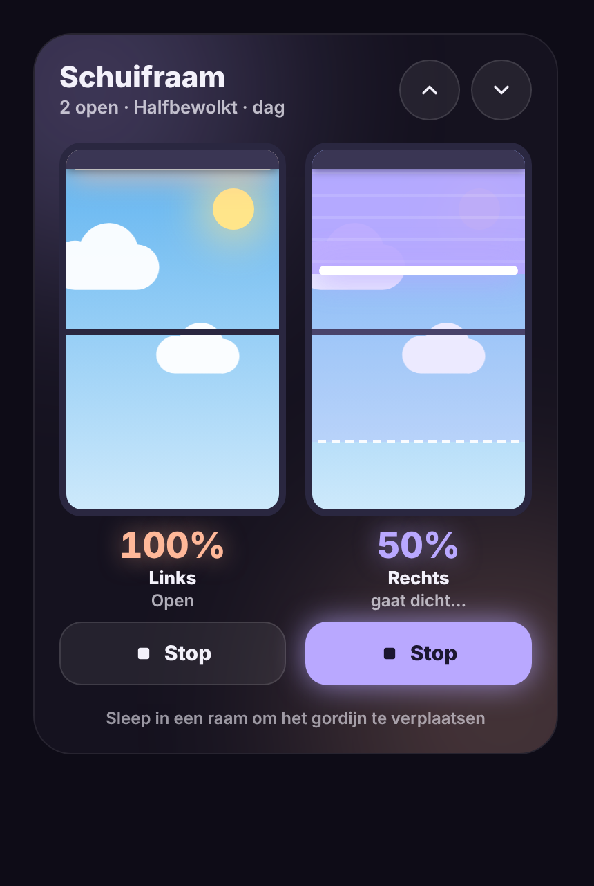 | [English](docs/blinds.md) · [Nederlands](docs/blinds.nl.md) |
| **Glow Energy Card** – solar, battery and grid with advice you can see from across the room. | 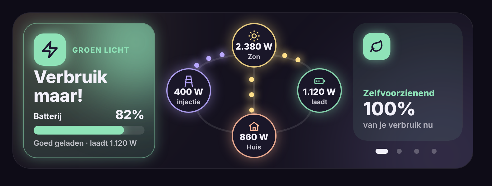 | [English](docs/energy.md) · [Nederlands](docs/energy.nl.md) |
| **Glow Room Card** – a room tile that glows in the colour of its lights: tap toggles, double tap opens a popup with scenes, lights (brightness, colour temperature and colour per light), covers, switches and climate. | 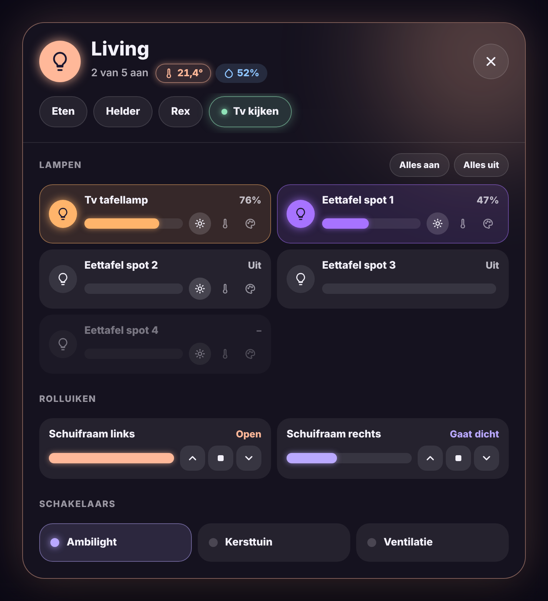 | [English](docs/room.md) · [Nederlands](docs/room.nl.md) |
| **Glow Scene Card** – a scene button that glows while the scene is still active (the lights are still as the scene set them). | 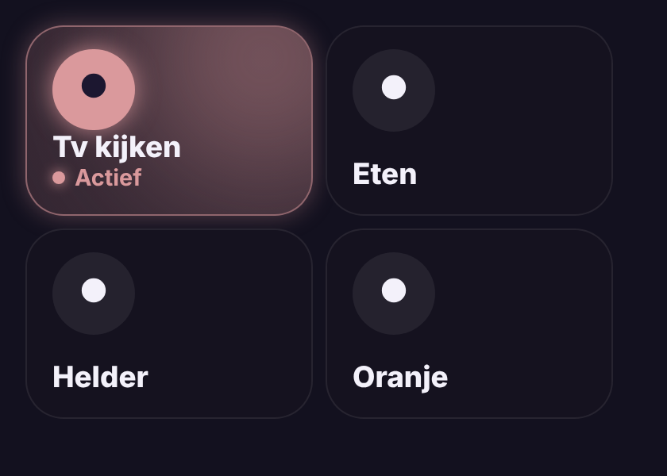 | [English](docs/scene.md) · [Nederlands](docs/scene.nl.md) |
| **Glow Navbar Card** – a navigation bar at the bottom of the screen to switch views, with dots for heating, alarm or the number of lights on. | 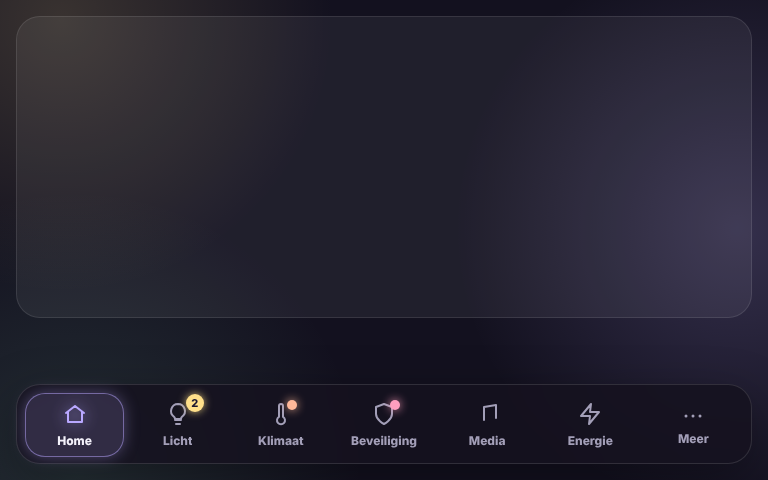 | [English](docs/navbar.md) · [Nederlands](docs/navbar.nl.md) |
| **Glow Welcome Card** – a welcome card without a background for the top of the dashboard: time, greeting, where everyone is, weather, the next waste collection and mail. | 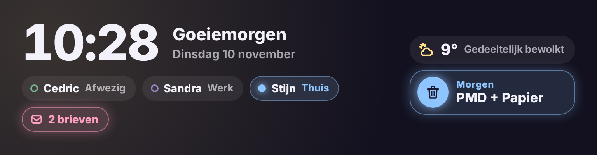 | [English](docs/welcome.md) · [Nederlands](docs/welcome.nl.md) |
| **Glow Security Card** – a large security card for Alarmo: an always-visible keypad, large mode buttons, and the openings and cameras you choose. | 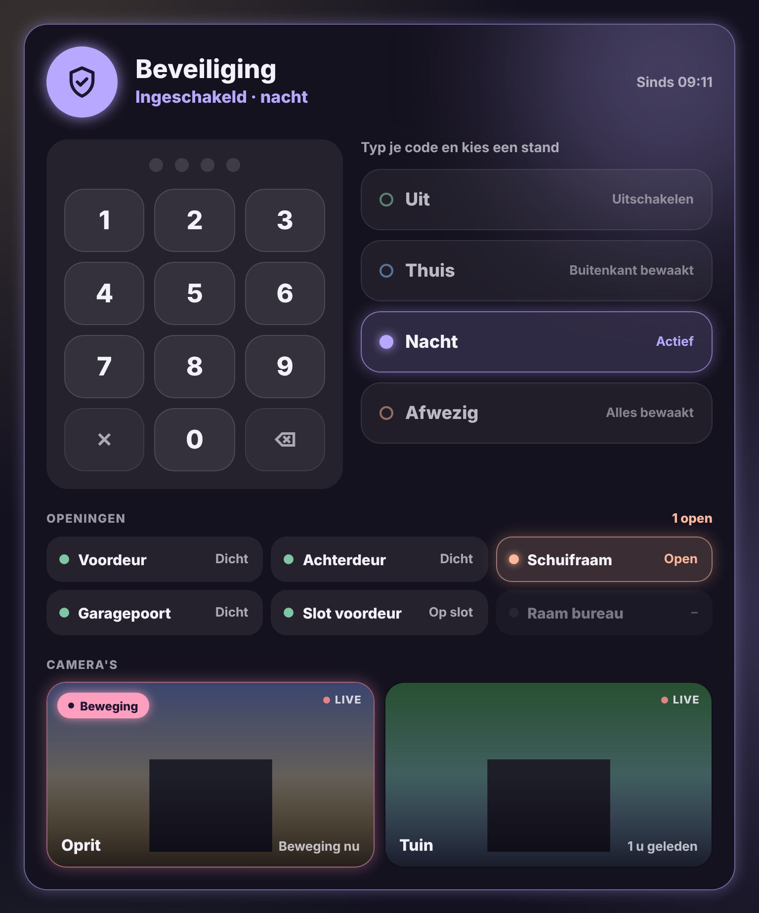 | [English](docs/security.md) · [Nederlands](docs/security.nl.md) |
| **Glow Fan Card** – a fan tile: tap toggles, with timer buttons and your own time. | 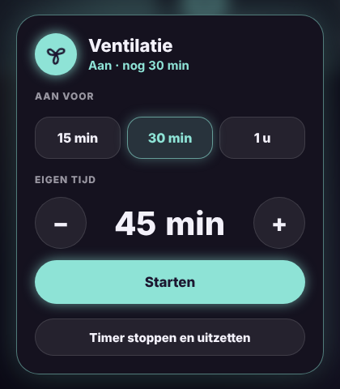 | [English](docs/fan.md) · [Nederlands](docs/fan.nl.md) |
| **Glow Garage Card** – a garage door tile: shows open or closed, operate with a confirmation tap. | 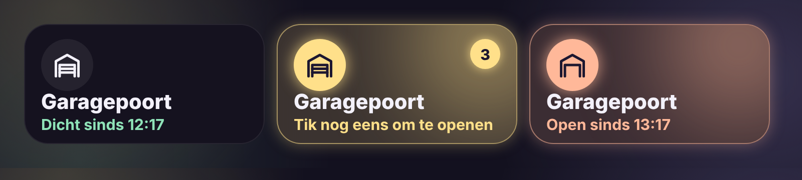 | [English](docs/garage.md) · [Nederlands](docs/garage.nl.md) |
| **Glow Thermostat Card** – a thermostat with a dial and a weekly schedule (comfort and eco) that runs in Home Assistant itself. | 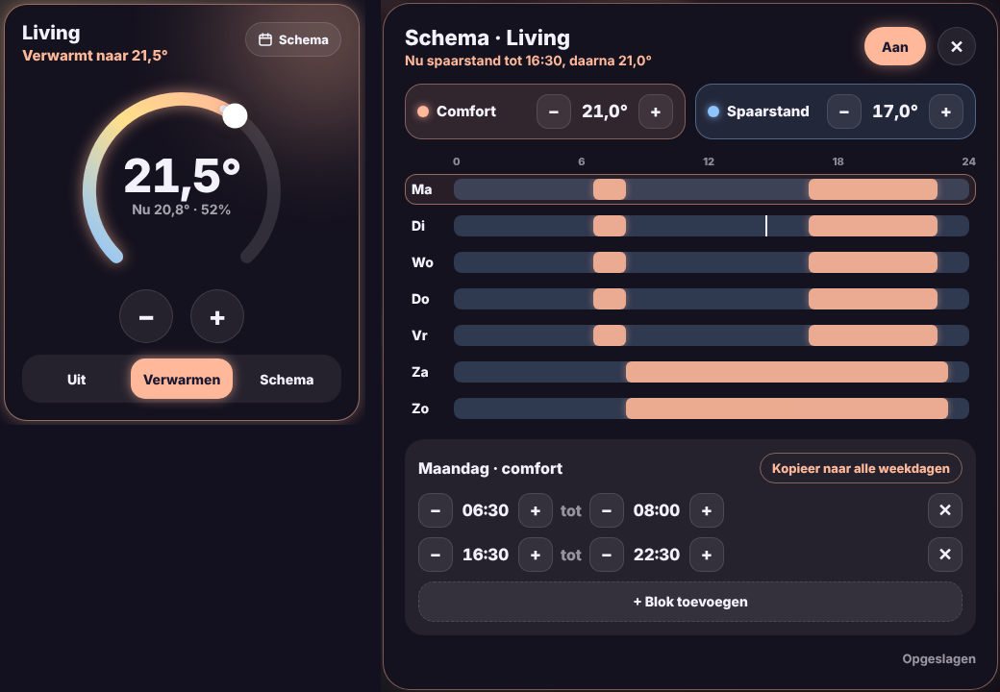 | [English](docs/thermostat.md) · [Nederlands](docs/thermostat.nl.md) |
| **Glow Salt Card** – the salt level of the water softener: a tank that empties, a refill warning and an estimate of when it runs out. | 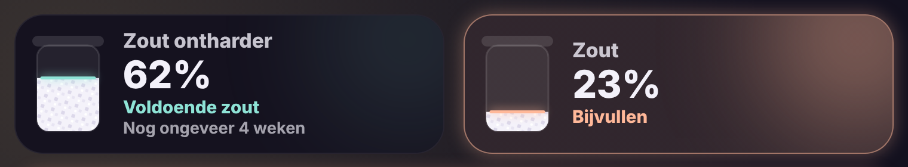 | [English](docs/salt.md) · [Nederlands](docs/salt.nl.md) |
| **Glow Media Card** – what is playing with artwork and glow, internet radio, Spotify playlists, speakers, play together and a sleep timer. | 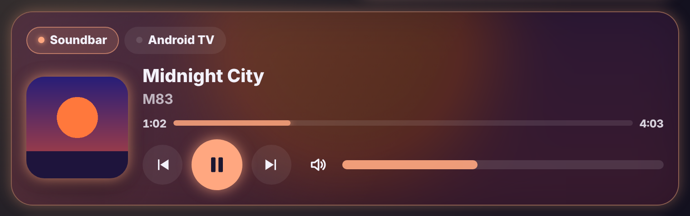 | [English](docs/media.md) · [Nederlands](docs/media.nl.md) |
| **Glow Weather Card** – the weather with a sky that follows it, a sun arc, details, an hourly temperature curve and daily bars. | 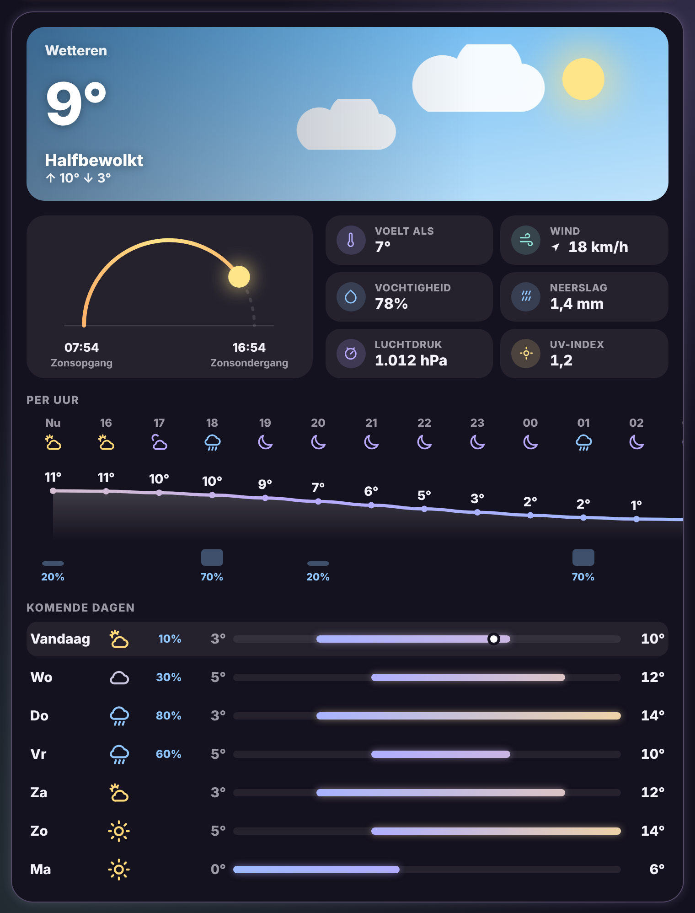 | [English](docs/weather.md) · [Nederlands](docs/weather.nl.md) |
| **Glow Usage Card** – gas, water and electricity usage: today, yesterday, week and month, with bars and cost. | 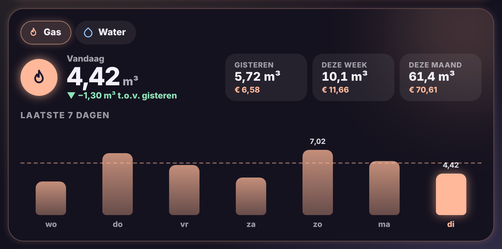 | [English](docs/usage.md) · [Nederlands](docs/usage.nl.md) |
| **Glow Doorbell Card** – live doorbell video, today's camera events and a popup on every view when someone rings. | 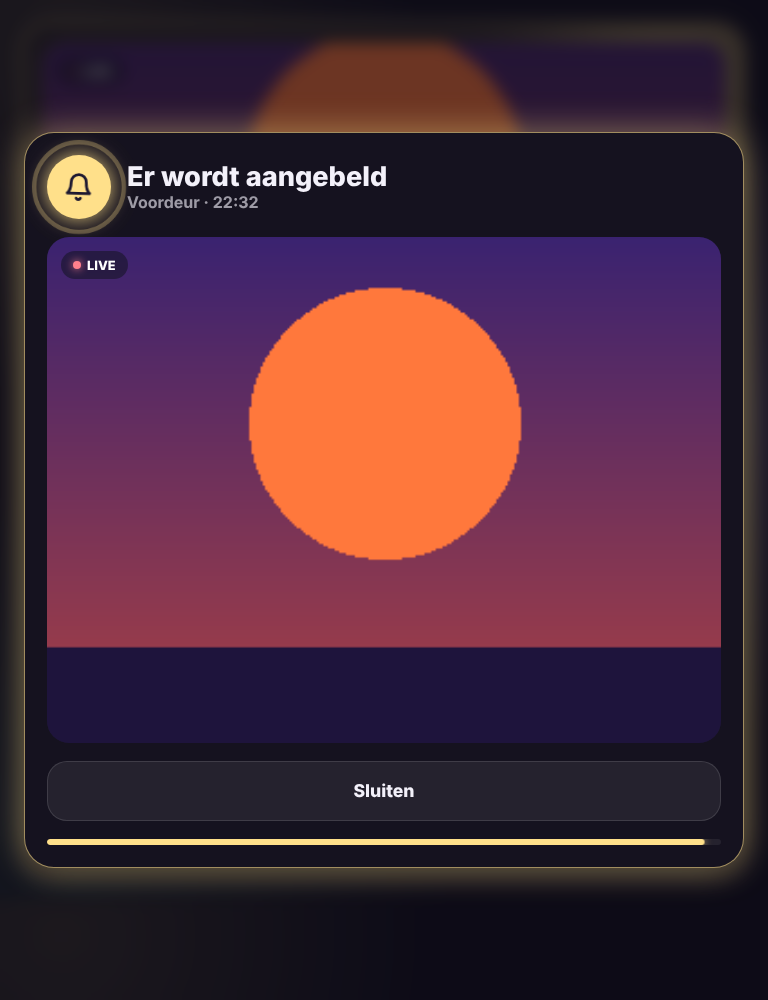 | [English](docs/doorbell.md) · [Nederlands](docs/doorbell.nl.md) |
| **Glow Battery Card** – home battery and inverter: level, working mode and every setting in a popup. | 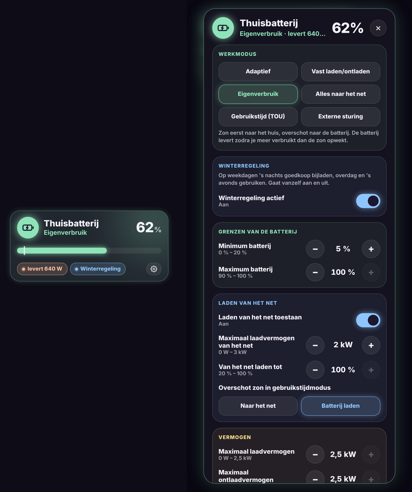 | [English](docs/battery.md) · [Nederlands](docs/battery.nl.md) |

All cards share the same look, support six languages (English, Dutch, French, German, Spanish, Italian) and have a visual editor.

## Glow Theme

The cards follow the light and dark mode of the matching [Glow Theme](https://github.com/stijnleroy/glow-theme). Without that theme they keep their own dark look.

## Installation via HACS

1. Open **HACS** → three dots top right → **Custom repositories**.
2. Repository: `https://github.com/stijnleroy/glow-cards`, type **Dashboard** → **Add**.
3. Search **Glow Cards** → **Download**, then reload your browser.

All cards are now available under **Add card**.

### Coming from the separate repositories?

The card types did not change (`custom:glow-blinds-card`, `custom:glow-energy-card`), so your dashboards keep working.

1. In HACS, **remove** Glow Blinds Card and Glow Energy Card. A card may only be loaded once.
2. Check **Settings → Dashboards → Resources** and delete any leftover `glow-blinds-card.js` or `glow-energy-card.js`.
3. Install **Glow Cards** as above and reload the browser.

## Development

Each card lives in `src/`. `node build.js` combines them into `dist/glow-cards.js`, the file HACS installs. The version is in `VERSION`.

## License

MIT
