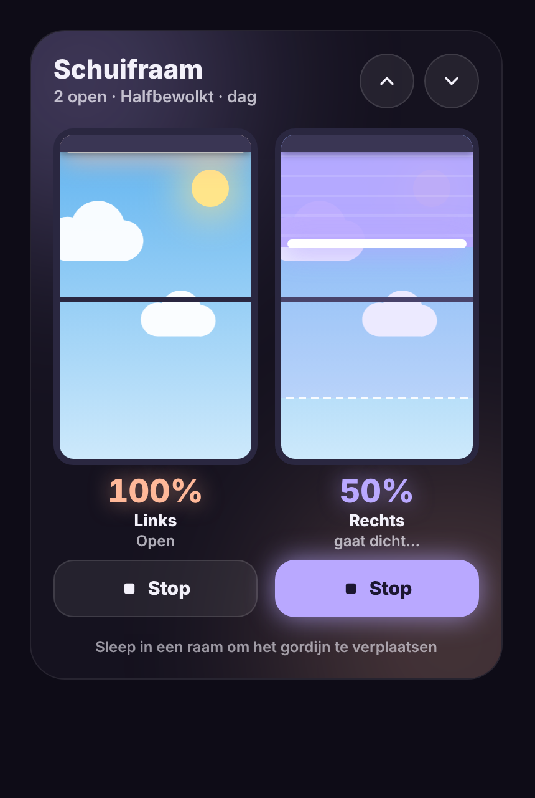
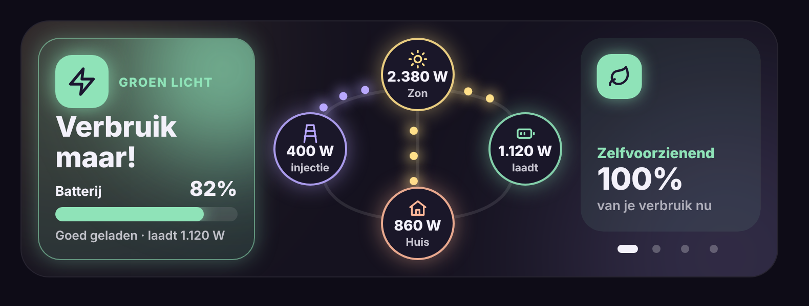
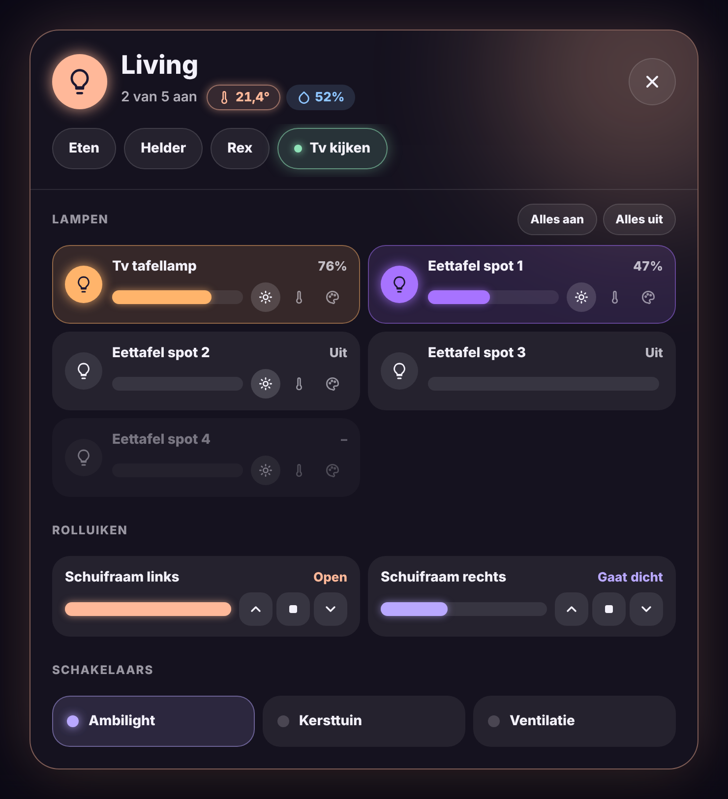
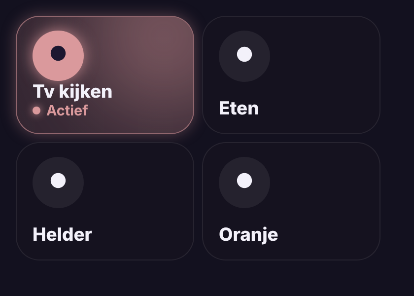
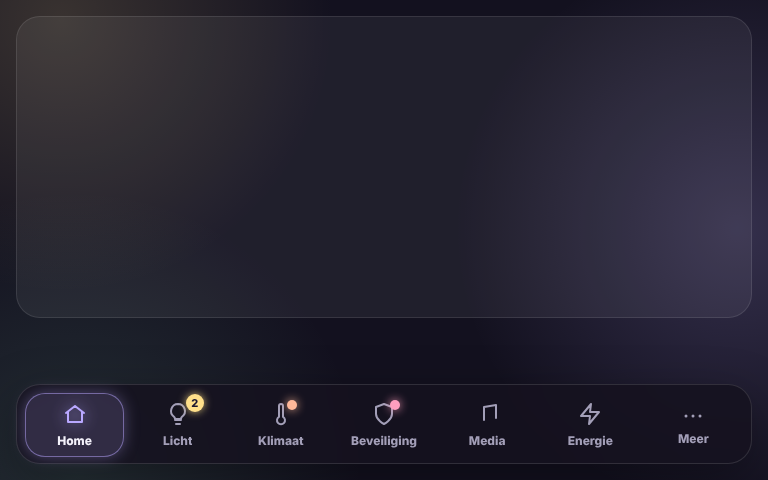
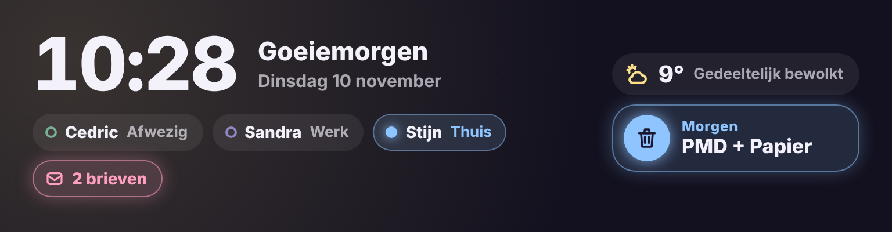
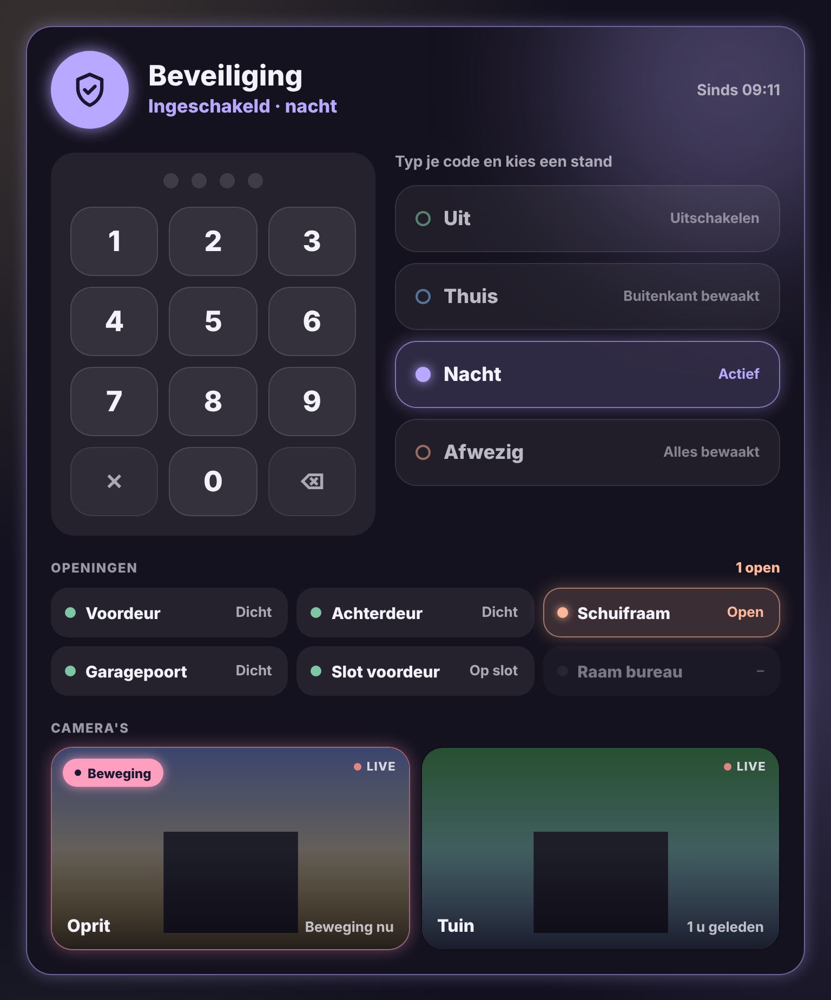
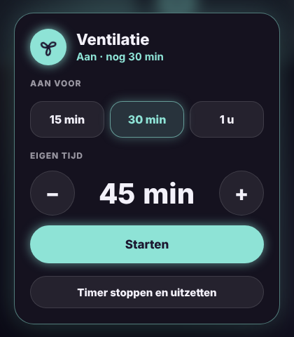
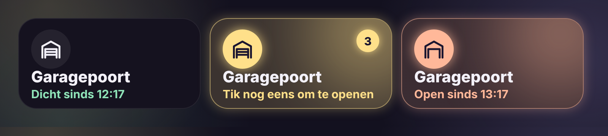
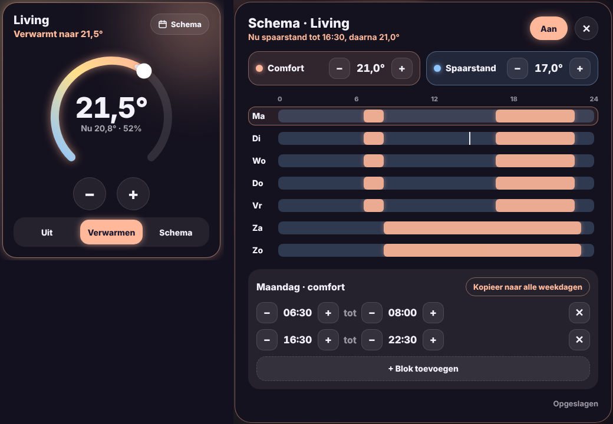

# Glow Cards

🇬🇧 [English](README.md) · 🇳🇱 Nederlands

Een familie van gloeiende dashboardkaarten voor Home Assistant, samen te installeren via HACS.

| Kaart | | Documentatie |
|---|---|---|
| **Glow Blinds Card** – rolgordijnen als verticale ramen: slepen, stop, live positie en een lucht die het weer volgt. |  | [Nederlands](docs/blinds.nl.md) · [English](docs/blinds.md) |
| **Glow Energy Card** – zon, batterij en net met een advies dat je van ver ziet. |  | [Nederlands](docs/energy.nl.md) · [English](docs/energy.md) |
| **Glow Room Card** – een kamertegel die gloeit in de kleur van de lampen: tik schakelt, dubbeltik opent een popup met scènes, lampen (helderheid, kleurtemperatuur en kleur per lamp), rolluiken, schakelaars en klimaat. |  | [Nederlands](docs/room.nl.md) · [English](docs/room.md) |
| **Glow Scene Card** – een scèneknop die gloeit zolang de scène nog actief is (de lampen staan nog zoals de scène ze zette). |  | [Nederlands](docs/scene.nl.md) · [English](docs/scene.md) |
| **Glow Navbar Card** – een navigatiebalk onderaan het scherm om van view te wisselen, met bolletjes voor verwarming, alarm of het aantal lampen aan. |  | [Nederlands](docs/navbar.nl.md) · [English](docs/navbar.md) |
| **Glow Welcome Card** – een welkomstkaart zonder achtergrond voor bovenaan: uur, begroeting, waar iedereen is, het weer, het eerstvolgende afval en de post. |  | [Nederlands](docs/welcome.nl.md) · [English](docs/welcome.md) |
| **Glow Security Card** – een grote beveiligingskaart voor Alarmo: altijd een klavier, grote standknoppen, de openingen en de camera's die je kiest. |  | [Nederlands](docs/security.nl.md) · [English](docs/security.md) |
| **Glow Fan Card** – een ventilatortegel: tik schakelt, met timerknoppen en een eigen tijd. |  | [Nederlands](docs/fan.nl.md) · [English](docs/fan.md) |
| **Glow Garage Card** – een garagepoorttegel: toont open of dicht, bedienen met een bevestigingstik. |  | [Nederlands](docs/garage.nl.md) · [English](docs/garage.md) |
| **Glow Thermostat Card** – een thermostaat met draaiknop en een weekschema (comfort en spaarstand) dat in Home Assistant zelf draait. |  | [Nederlands](docs/thermostat.nl.md) · [English](docs/thermostat.md) |

Alle kaarten delen dezelfde stijl, spreken zes talen (Nederlands, Engels, Frans, Duits, Spaans, Italiaans) en hebben een visuele editor.

## Glow-thema

De kaarten volgen de lichte en donkere versie van het bijpassende [Glow-thema](https://github.com/stijnleroy/glow-theme). Zonder dat thema houden ze hun eigen donkere stijl.

## Installeren via HACS

1. Open **HACS** → drie puntjes rechtsboven → **Custom repositories**.
2. Repository: `https://github.com/stijnleroy/glow-cards`, type **Dashboard** → **Add**.
3. Zoek **Glow Cards** → **Download** en herlaad je browser.

Alle kaarten staan daarna bij **Kaart toevoegen**.

### Kom je van de losse repo's?

De namen van de kaarten blijven dezelfde (`custom:glow-blinds-card`, `custom:glow-energy-card`), dus je dashboards blijven werken.

1. **Verwijder** in HACS Glow Blinds Card en Glow Energy Card. Een kaart mag maar één keer geladen worden.
2. Kijk bij **Instellingen → Dashboards → Resources** of er nog een `glow-blinds-card.js` of `glow-energy-card.js` staat, en verwijder die.
3. Installeer **Glow Cards** zoals hierboven en herlaad de browser.

## Ontwikkeling

Elke kaart staat in `src/`. `node build.js` voegt ze samen tot `dist/glow-cards.js`, het bestand dat HACS installeert. Het versienummer staat in `VERSION`.

## Licentie

MIT
