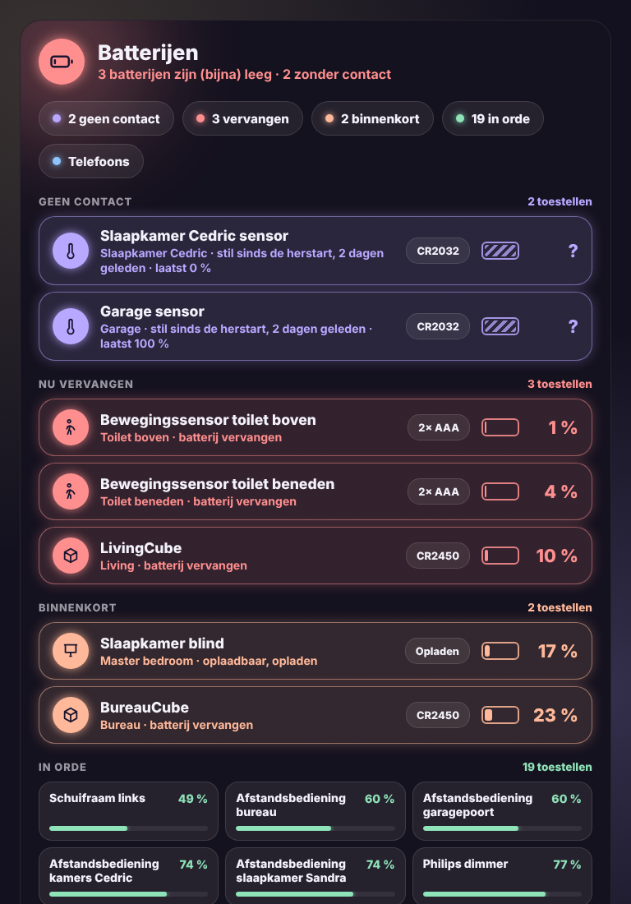

# Glow Batteries Card

🇬🇧 English · 🇳🇱 [Nederlands](batteries.nl.md)



The batteries of all your devices on one card: what to replace now, what is getting weak, and which devices stopped reporting.

- **Automatic**: finds every battery sensor (`device_class: battery`, in %). A home battery is left out, it has its own card.
- **No contact**: a device that stays silent too long goes to the top with a question mark. Its percentage can no longer be trusted: a sensor that says 30 % may already be empty. The card looks at the last signal of *every* part of the device (a door sensor that still reports open/closed is alive). Sensors after 24 hours, remotes, switches and cubes after 7 days, because they usually only report when used.
- **Replace now** (10 % or less) and **Soon** (25 % or less) are shown large, with the battery it takes (e.g. `2× AAA`, `CR2032`) or "Charge" for rechargeable devices like roller blinds.
- **Fine**: compact, weakest first.
- **Phones and tablets** (Companion app, Fully Kiosk) in their own group.
- **Filter**: tap a button at the top to see only that group. Tap a device for its details.

Home Assistant keeps the last signal until the last restart. After a restart the card says "silent since the restart". For the exact moment, enable `last_seen` in Zigbee2MQTT and turn on the *Last seen* sensors: the card uses them automatically.

```yaml
type: custom:glow-batteries-card
```

| Option | Default | Description |
|---|---|---|
| `title` | Batteries | Title. |
| `entities` | all | Pick your own list of battery sensors. |
| `exclude` | – | Battery sensors to hide. |
| `phones` | `true` | Show phones and tablets. |
| `critical` | `10` | From this percentage: replace now. |
| `low` | `25` | From this percentage: soon. |
| `stale_hours` | `24` | Hours without a report before a sensor counts as "no contact". |
| `stale_hours_remote` | `168` | The same for remotes, switches and cubes. |
| `types` | – | Battery type per sensor, e.g. `sensor.office_battery: 2× AA`. |
| `glow` | `15` | Glow strength (px). |
| `language` | auto | `nl`, `en`, `fr`, `de`, `es`, `it`. |
