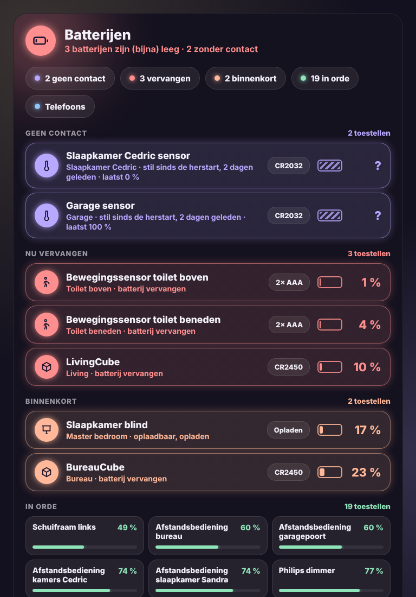

# Glow Batteries Card

🇬🇧 [English](batteries.md) · 🇳🇱 Nederlands



De batterijen van al je toestellen op één kaart: wat nu vervangen moet, wat binnenkort zwak wordt, en welke toestellen niets meer melden.

- **Vanzelf**: de kaart zoekt alle batterijsensoren (`device_class: battery`, in %). Een thuisbatterij laat ze weg, die heeft een eigen kaart.
- **Geen contact**: een toestel dat te lang niets meldt, komt bovenaan met een vraagteken. Het percentage klopt dan niet meer: een sensor die 30 % meldt kan al leeg zijn. De kaart kijkt naar het laatste signaal van élk onderdeel van het toestel (een deursensor die nog open/dicht meldt, leeft nog). Sensoren na 24 uur, afstandsbedieningen, schakelaars en cubes na 7 dagen, omdat die zich meestal alleen melden als je ze gebruikt.
- **Nu vervangen** (10 % of minder) en **Binnenkort** (25 % of minder) staan groot, met welke batterij erin moet (bv. `2× AAA`, `CR2032`) of "Opladen" bij oplaadbare toestellen zoals rolgordijnen.
- **In orde**: compact, de zwakste eerst.
- **Telefoons en tablets** (Companion-app, Fully Kiosk) in een eigen groep.
- **Filter**: tik op een knop bovenaan om alleen die groep te zien. Tik op een toestel voor de details.

Home Assistant onthoudt het laatste signaal tot de laatste herstart. Na een herstart toont de kaart "stil sinds de herstart". Wil je het exacte moment, zet dan in Zigbee2MQTT `last_seen` aan en schakel de sensoren *Last seen* in: de kaart gebruikt die vanzelf.

```yaml
type: custom:glow-batteries-card
```

| Optie | Standaard | Uitleg |
|---|---|---|
| `title` | Batterijen | Titel. |
| `entities` | alle | Zelf een lijst batterijsensoren kiezen. |
| `exclude` | – | Batterijsensoren die je niet wil zien. |
| `phones` | `true` | Telefoons en tablets tonen. |
| `critical` | `10` | Vanaf dit percentage: nu vervangen. |
| `low` | `25` | Vanaf dit percentage: binnenkort. |
| `stale_hours` | `24` | Uren zonder melding voor sensoren voor "geen contact". |
| `stale_hours_remote` | `168` | Hetzelfde voor afstandsbedieningen, schakelaars en cubes. |
| `types` | – | Batterijtype per sensor, bv. `sensor.bureau_battery: 2× AA`. |
| `glow` | `15` | Sterkte van de gloed (px). |
| `language` | auto | `nl`, `en`, `fr`, `de`, `es`, `it`. |
