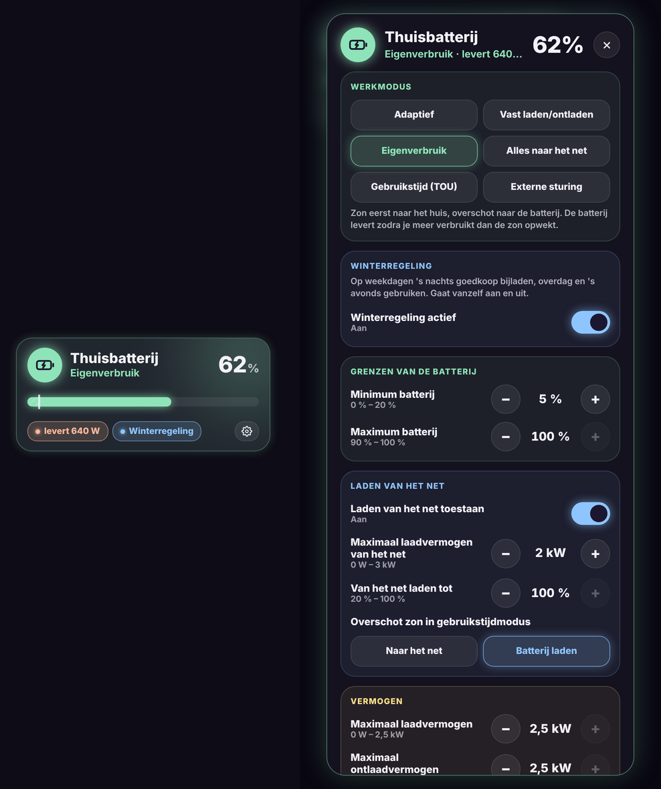

# Glow Battery Card

🇬🇧 English · 🇳🇱 [Nederlands](battery.nl.md)



A Glow-style tile for your home battery and inverter, with every setting in a popup.

- **Tile**: battery level, working mode and a bar showing your minimum (and maximum when below 100 %). Below it you see whether the battery is charging or supplying, and whether winter mode or the peak reserve is on.
- **Tap**: the popup with all settings by topic: working mode, winter mode, limits, grid charging, power, peak shaving, inverter and "charge now".
- **Long press**: the regular details of the battery level.

In the popup:
- **Choices** (working mode, peak shaving …) are buttons. Working mode, peak shaving and inverter on/off ask for a **second tap to confirm**.
- **Numbers** are set with − and +. The card sends the new value after a short pause, so you can tap a few times.
- **Switches** toggle immediately.

Settings from the [Huawei Solar](https://github.com/wlcrs/huawei_solar) integration are **found automatically**. Settings your inverter doesn't report (unknown or unavailable) are left out.

```yaml
type: custom:glow-battery-card
name: Home battery
winter: input_boolean.battery_winter_mode
battery_device: <device id of "Batteries">   # for "Charge to … % now"
charge_targets: [60, 100]
```

| Option | Default | Description |
|---|---|---|
| `name` | Home battery | Name on the tile. |
| `soc` | detected | Battery level sensor. |
| `power` | detected | Charge/discharge power (positive = charging). |
| `invert` | `false` | Invert the sign of `power`. |
| `winter` | – | An `input_boolean` (or automation) for a winter mode. Shown as its own section. |
| `battery_device` | – | The Huawei **Batteries** device. Shows **Charge to … % now** buttons (uses `huawei_solar.forcible_charge_soc`). |
| `charge_targets` | `[60, 100]` | Percentages for those buttons. |
| `extra` | – | List of extra entities (number, select, switch, button, sensor …) in an **Extra** section. |
| `sections` | Huawei layout | Your own layout, see below. |
| `mode`, `eod`, `eoc`, `grid_charge` … | detected | Replace a detected entity, or hide it with `''`. |
| `confirm` | `true` | `false` turns off confirmation. |
| `show_unavailable` | `false` | Also show unavailable settings. |
| `color` | mint | Glow colour, e.g. `'#8FE3B8'`. |
| `glow` | `18` | Glow strength in pixels. |
| `language` | automatic | `nl`, `en`, `fr`, `de`, `es` or `it`. |

## Extra entities or your own layout

```yaml
type: custom:glow-battery-card
extra:
  - number.my_new_setting
  - entity: switch.something
    name: Something
sections:            # replaces the default layout
  - title: Battery
    color: '#8FE3B8'
    items:
      - select.battery_working_mode
      - entity: number.battery_end_of_discharge_soc
        name: Minimum
        step: 5
```

Per entity you can set `name` and (for numbers) `step`. The default step is 100 for W and 1 for %.

## Winter mode

See the [Dutch documentation](battery.nl.md#winterregeling) for an example with an `input_boolean` and two automations that charge the battery on weekday nights in winter (time-of-use mode) and switch back to self-consumption in spring.
