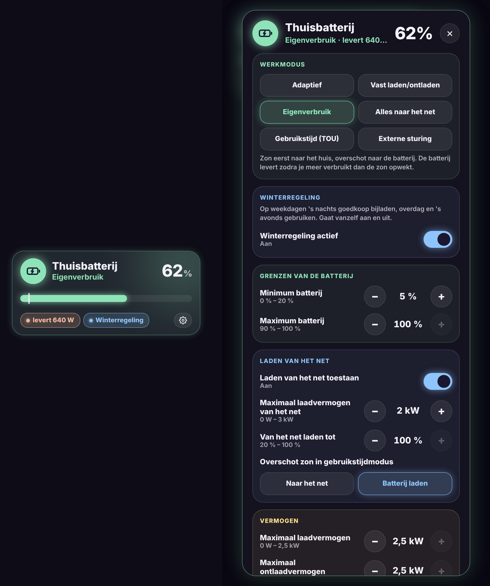

# Glow Battery Card

🇬🇧 [English](battery.md) · 🇳🇱 Nederlands



Een tegel voor je thuisbatterij en omvormer in de Glow-stijl, met alle instellingen in een popup.

- **Tegel**: het batterijpercentage, de werkmodus en een balk met je minimum (en maximum als dat onder 100 % ligt). Daaronder zie je of de batterij laadt of levert en of de winterregeling of de piekreserve aan staat.
- **Tik**: de popup met alle instellingen, per thema: werkmodus, winterregeling, grenzen, laden van het net, vermogen, piekbeperking, omvormer en "nu laden".
- **Lang drukken**: de gewone details van het batterijpercentage.

In de popup:
- **Keuzes** (werkmodus, piekbeperking …) zijn knoppen. De werkmodus, de piekbeperking en de omvormer aan/uit vragen een **tweede tik ter bevestiging**.
- **Getallen** stel je in met − en +. De kaart stuurt de nieuwe waarde pas na een korte pauze, zodat je een paar keer kunt tikken.
- **Schakelaars** gaan meteen aan of uit.

De instellingen van de integratie [Huawei Solar](https://github.com/wlcrs/huawei_solar) worden **vanzelf gevonden**. Instellingen die je omvormer niet doorgeeft (onbekend of niet beschikbaar) laat de kaart weg.

```yaml
type: custom:glow-battery-card
name: Thuisbatterij
winter: input_boolean.batterij_winterregeling
battery_device: 1b4e39095e1fa94118ce4560a5c4af6a   # apparaat "Batterijen", voor "Nu laden tot"
charge_targets: [60, 100]
```

| Optie | Standaard | Uitleg |
|---|---|---|
| `name` | Thuisbatterij | Naam op de tegel. |
| `soc` | gevonden | Sensor met het batterijpercentage. |
| `power` | gevonden | Laad/ontlaadvermogen (positief = laden). |
| `invert` | `false` | Teken van `power` omkeren. |
| `winter` | – | Een `input_boolean` (of automatisering) voor een winterregeling. Verschijnt als eigen sectie. |
| `battery_device` | – | Het Huawei-apparaat **Batterijen**. Toont knoppen **Nu laden tot … %** (gebruikt `huawei_solar.forcible_charge_soc`). |
| `charge_targets` | `[60, 100]` | Percentages voor die knoppen. |
| `extra` | – | Lijst met extra entiteiten (number, select, switch, button, sensor …) in een sectie **Extra**. |
| `sections` | Huawei-indeling | Eigen indeling, zie hieronder. |
| `mode`, `eod`, `eoc`, `grid_charge` … | gevonden | Een gevonden entiteit vervangen, of met `''` verbergen. |
| `confirm` | `true` | Met `false` vraagt de kaart geen bevestiging. |
| `show_unavailable` | `false` | Ook onbeschikbare instellingen tonen. |
| `color` | mint | Gloedkleur, bv. `'#8FE3B8'`. |
| `glow` | `18` | Sterkte van de gloed in pixels. |
| `language` | automatisch | `nl`, `en`, `fr`, `de`, `es` of `it`. |

## Extra entiteiten of een eigen indeling

```yaml
type: custom:glow-battery-card
extra:
  - number.mijn_nieuwe_instelling
  - entity: switch.iets
    name: Iets
sections:            # vervangt de standaardindeling
  - title: Batterij
    color: '#8FE3B8'
    items:
      - select.battery_working_mode
      - entity: number.battery_end_of_discharge_soc
        name: Minimum
        step: 5
```

Per entiteit kies je `name` en (bij getallen) `step`. Standaard is de stap 100 voor W en 1 voor %.

## Winterregeling

Met een dag/nachttarief kan het in de winter lonen om de batterij op weekdagen 's nachts te laden en overdag en 's avonds te gebruiken. Een voorbeeld met een `input_boolean.batterij_winterregeling` en twee automatiseringen:

```yaml
alias: Batterij – winterregeling volgens datum
triggers:
  - trigger: time
    at: "00:05:00"
  - trigger: homeassistant
    event: start
actions:
  - action: "input_boolean.turn_{{ 'on' if now().month in [11, 12, 1, 2] else 'off' }}"
    target:
      entity_id: input_boolean.batterij_winterregeling
```

```yaml
alias: Batterij – winterregeling toepassen
mode: restart
triggers:
  - trigger: state
    entity_id: input_boolean.batterij_winterregeling
    to: ["on", "off"]
actions:
  - if:
      - condition: state
        entity_id: input_boolean.batterij_winterregeling
        state: "on"
    then:
      - action: huawei_solar.set_tou_periods
        data:
          device_id: <apparaat Batterijen>
          periods: |-
            00:00-01:00/12345/-
            01:00-06:00/12345/+
            06:00-24:00/12345/-
            00:00-24:00/67/-
      - action: number.set_value
        target: { entity_id: number.battery_grid_charge_maximum_power }
        data: { value: 1500 }
      - action: number.set_value
        target: { entity_id: number.battery_grid_charge_cutoff_soc }
        data: { value: 90 }
      - action: select.select_option
        target: { entity_id: select.battery_excess_pv_energy_use_in_tou }
        data: { option: charge }
      - action: switch.turn_on
        target: { entity_id: switch.battery_charge_from_grid }
      - action: select.select_option
        target: { entity_id: select.battery_working_mode }
        data: { option: time_of_use_luna2000 }
    else:
      - action: select.select_option
        target: { entity_id: select.battery_working_mode }
        data: { option: maximise_self_consumption }
      - action: switch.turn_off
        target: { entity_id: switch.battery_charge_from_grid }
```

`+` is laden, `-` is ontladen, `1` = maandag … `7` = zondag.
