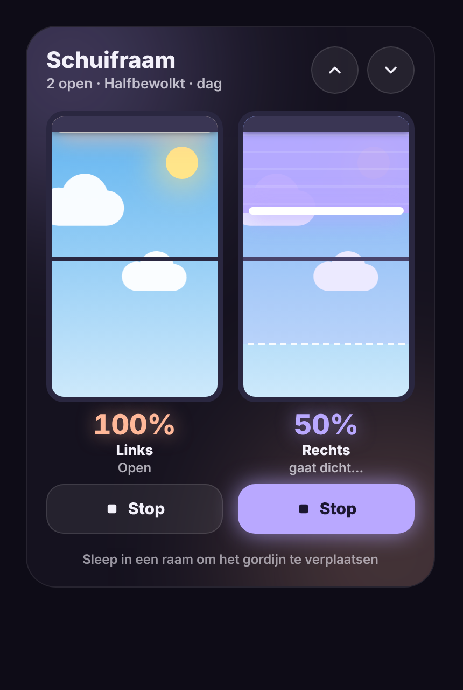

# Glow Blinds Card

🇬🇧 English · 🇳🇱 [Nederlands](blinds.nl.md)

A Home Assistant dashboard card that shows your roller blinds the way they actually hang: vertically, inside a window.



## Features

- **Drag** inside a window to send the blind to a position. A dashed line and a label show live where you are dragging to.
- **Live position**: the percentage and the fabric follow `current_position` while the motor runs. Integrations that report the target position straight away (optimistically) no longer make the blind jump back and forth.
- **Stop button** per blind. It lights up while the blind is moving, also for motors that don't report `opening`/`closing`.
- **Open all / close all** with two buttons at the top.
- **Sky behind the window** that follows the weather (sun, clouds, rain, thunderstorm, snow, fog) and the time of day (day, twilight, night). One sun or moon for the whole card.
- **Your own colour per blind**, with a glow in that colour.
- **Fabric type** per blind: dimout (partly darkening) or blackout.
- **As many blinds as you like**, spread over columns automatically.
- **Visual editor**: set everything up without YAML.
- **Six languages**: English, Dutch, French, German, Spanish and Italian, picked automatically from your Home Assistant language.
- Keyboard support (arrow up/down, Home, End).

## Installation via HACS

1. Open **HACS** in Home Assistant.
2. Click the three dots in the top right and choose **Custom repositories**.
3. Fill in:
   - Repository: `https://github.com/stijnleroy/glow-cards`
   - Type: **Dashboard**
4. Click **Add**, then search for **Glow Cards** and click **Download**.
5. Reload your browser (on a wall tablet: clear the browser cache or restart the app).

HACS normally adds the resource automatically. If it doesn't, add it yourself under **Settings → Dashboards → Resources**:

```
/hacsfiles/glow-cards/glow-cards.js   (type: JavaScript module)
```

## Usage

Edit your dashboard, click **Add card** and choose **Glow Blinds Card**. Or in YAML:

```yaml
type: custom:glow-blinds-card
title: Sliding door
weather: weather.home
blinds:
  - entity: cover.sliding_door_left
    name: Left
    color: "#FFB899"
  - entity: cover.sliding_door_right
    name: Right
    color: "#B9A8FF"
    fabric: blackout
    travel_time: 25
```

### Card options

| Option | Default | Description |
|---|---|---|
| `title` | translated "Blinds" | Title at the top. Use `""` for no title. |
| `blinds` | required | List of blinds (see below). |
| `weather` | – | Weather entity for the sky behind the window. Without one, the sky is clear. |
| `sun` | `sun.sun` | Sun entity for day, twilight and night. |
| `glow` | `15` | Glow strength in pixels (0 = no glow). |
| `columns` | automatic | Number of columns. Automatic: 1–3 blinds side by side, 4 as 2×2, more in rows of 3. |
| `height` | automatic | Window height in pixels (270 for one row, 170 for several rows). |
| `background` | `dark` | `dark` = dark with glow, `theme` = your dashboard theme background. |
| `sky` | `true` | `false` shows a plain dark sky. |
| `show_all_buttons` | `true` | Show the open all / close all buttons. |
| `show_hint` | `true` | Show the "Drag inside a window…" hint at the bottom. |
| `language` | automatic | Card language: `en`, `nl`, `fr`, `de`, `es` or `it`. Defaults to your Home Assistant language (English for other languages). |
| `fabric` | `dimout` | Default fabric type for all blinds: `dimout` or `blackout`. |
| `travel_time` | `30` | Default travel time in seconds for all blinds (see below). |

### Options per blind

| Option | Description |
|---|---|
| `entity` | The `cover` entity (required). |
| `name` | Name below the window. Defaults to the entity name. |
| `color` | Colour of the fabric and glow, e.g. `"#8FE3B8"`. |
| `fabric` | `dimout` = partly darkening (you can still see the sky through the fabric), `blackout` = fully darkening. |
| `travel_time` | Seconds the blind needs from fully open to fully closed (default 30). Used to estimate movement for motors that don't report it. |
| `invert` | `true` if your blind reports 0 = open and 100 = closed. |

A blind that can't set a position (open/close only) opens fully when released above the middle and closes fully below it.

## Translations

Want another language? Open an issue or pull request with the texts from the `GBC_I18N` table in `src/blinds.js`.

## License

MIT
