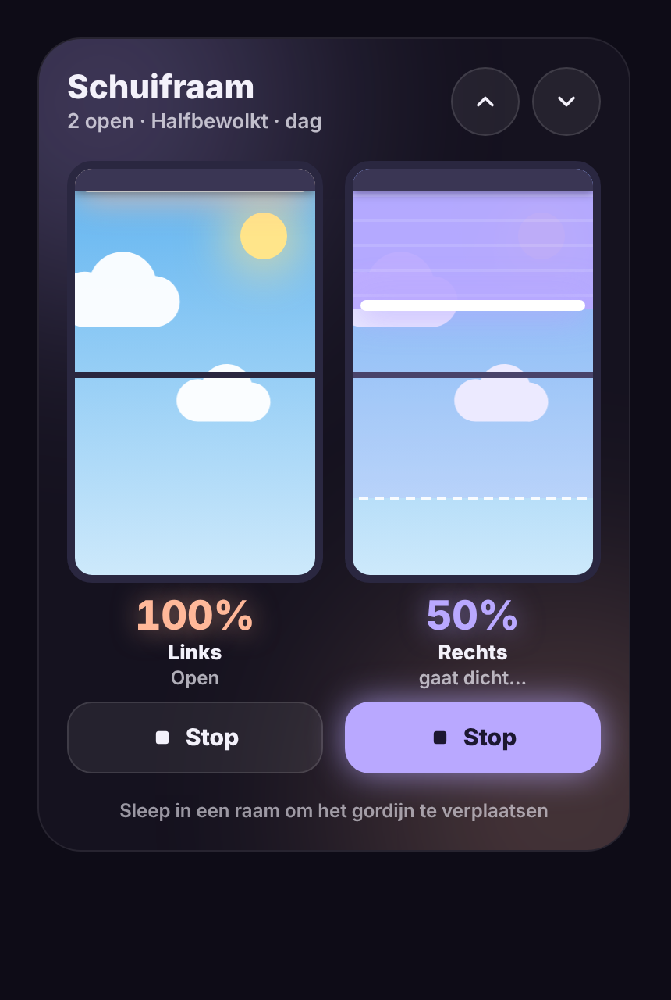

# Glow Blinds Card

🇬🇧 [English](blinds.md) · 🇳🇱 Nederlands

Een dashboardkaart voor Home Assistant die je rolgordijnen toont zoals ze echt hangen: verticaal, in een raam.



## Wat kan de kaart?

- **Slepen** in een raam om het gordijn naar een positie te sturen. Een stippellijn en een label tonen live waar je naartoe sleept.
- **Live positie**: het percentage en de stof volgen `current_position` terwijl de motor draait.
- **Stopknop** per gordijn. Die licht op zolang het gordijn beweegt.
- **Alles open / alles dicht** met twee knoppen bovenaan.
- **Lucht achter het raam** die het weer (zon, wolken, regen, onweer, sneeuw, mist) en het dagdeel (dag, schemer, nacht) volgt.
- **Eigen kleur per gordijn**, met een gloed in die kleur.
- **Zoveel gordijnen als je wilt**. Ze worden automatisch over kolommen verdeeld.
- **Visuele editor**: alles instellen zonder YAML.
- **Zes talen**: Nederlands, Engels, Frans, Duits, Spaans en Italiaans, automatisch volgens je Home Assistant.
- Werkt ook met het toetsenbord (pijltjes omhoog/omlaag, Home, End).

## Installeren via HACS

1. Open **HACS** in Home Assistant.
2. Klik rechtsboven op de drie puntjes en kies **Custom repositories**.
3. Vul in:
   - Repository: `https://github.com/stijnleroy/glow-cards`
   - Type: **Dashboard**
4. Klik **Add**, zoek daarna **Glow Cards** en klik **Download**.
5. Herlaad je browser (op de tablet: browsercache wissen of de app herstarten).

HACS voegt de resource normaal automatisch toe. Gebeurt dat niet, voeg dan zelf toe via **Instellingen → Dashboards → Resources**:

```
/hacsfiles/glow-cards/glow-cards.js   (type: JavaScript module)
```

## Gebruik

Bewerk je dashboard, klik **Kaart toevoegen** en kies **Glow Blinds Card**. Of in YAML:

```yaml
type: custom:glow-blinds-card
title: Schuifraam
weather: weather.buienradar
blinds:
  - entity: cover.schuifraam_links
    name: Links
    color: "#FFB899"
  - entity: cover.schuifraam_rechts
    name: Rechts
    color: "#B9A8FF"
```

### Opties

| Optie | Standaard | Uitleg |
|---|---|---|
| `title` | "Rolgordijnen" in je eigen taal | Titel bovenaan. Laat leeg (`""`) voor geen titel. |
| `blinds` | verplicht | Lijst met gordijnen (zie hieronder). |
| `weather` | – | Weer-entiteit voor de lucht achter het raam. Zonder weer-entiteit is de lucht helder. |
| `sun` | `sun.sun` | Zon-entiteit voor dag, schemer en nacht. |
| `glow` | `22` | Sterkte van de gloed in pixels (0 = geen gloed). |
| `columns` | automatisch | Aantal kolommen. Automatisch: 1–3 gordijnen naast elkaar, 4 in 2×2, meer in rijen van 3. |
| `height` | automatisch | Hoogte van de ramen in pixels (270 bij één rij, 170 bij meerdere rijen). |
| `background` | `dark` | `dark` = donker met gloed, `theme` = achtergrond van je dashboardthema. |
| `sky` | `true` | `false` toont een effen donkere lucht. |
| `show_all_buttons` | `true` | Knoppen voor alles open/dicht tonen. |
| `show_hint` | `true` | Uitleg "Sleep in een raam…" onderaan tonen. |
| `fabric` | `dimout` | Standaard soort stof voor alle gordijnen: `dimout` of `blackout`. |
| `language` | automatisch | Taal van de kaart: `nl`, `en`, `fr`, `de`, `es` of `it`. Standaard de taal van Home Assistant (Engels voor andere talen). |
| `travel_time` | `30` | Standaard looptijd in seconden voor alle gordijnen (zie hieronder). |

### Opties per gordijn

| Optie | Uitleg |
|---|---|
| `entity` | De `cover`-entiteit (verplicht). |
| `name` | Naam onder het raam. Standaard de naam van de entiteit. |
| `color` | Kleur van de stof en de gloed, bv. `"#8FE3B8"`. |
| `fabric` | `dimout` = deels verduisterend (je ziet de lucht nog wat door de stof), `blackout` = volledig verduisterend. Standaard `dimout`. |
| `invert` | `true` als je gordijn 0 = open en 100 = dicht rapporteert. |
| `travel_time` | Hoeveel seconden het gordijn nodig heeft van helemaal open tot helemaal dicht (standaard 30). Wordt gebruikt om de stopknop te laten oplichten bij motoren die niet melden dat ze bewegen. |

Een gordijn dat geen positie kan instellen (alleen open/dicht), gaat bij loslaten volledig open (boven de helft) of dicht (onder de helft).

## Licentie

MIT
