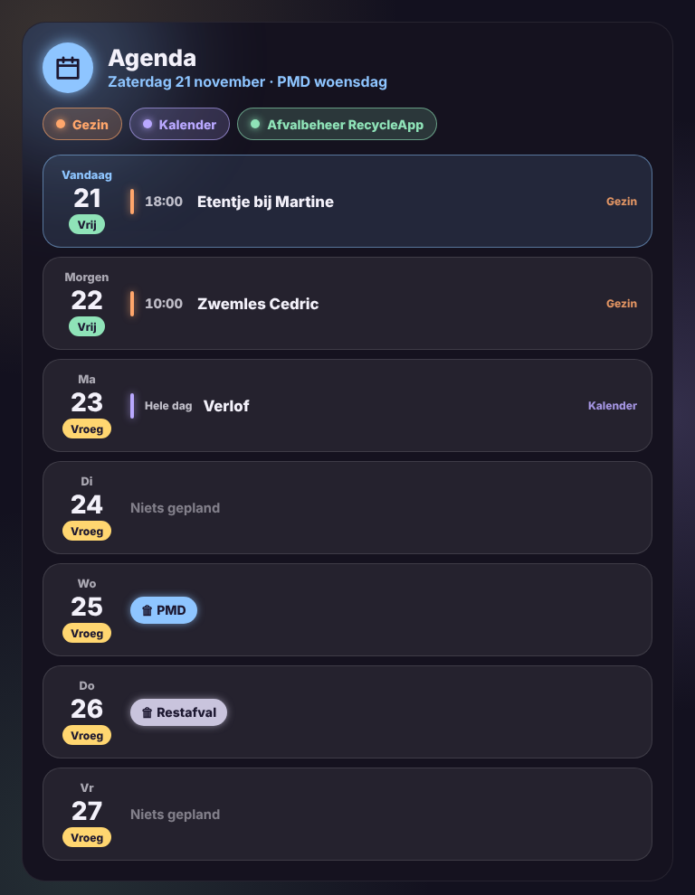

# Glow Calendar Card

🇬🇧 English · 🇳🇱 [Nederlands](calendar.nl.md)



The coming days from your calendars in one overview.

- **Per day** your events with time (or "All day"), in the calendar's colour.
- **Waste collection** as coloured tags: PMD blue, organic green, paper yellow, general grey. The card finds the waste calendar itself (name with waste, recycle, afval…), or set `waste`.
- **Shift**: with [Glow Schedules](https://github.com/stijnleroy/glow-schedules) each day shows the shift (early, late, off).
- **At the top** the next collection, and chips to hide calendars.

```yaml
type: custom:glow-calendar-card
calendars:
  - calendar.icloud_gezin
  - entity: calendar.kalender
    name: Werk
    color: 255, 166, 107
waste: calendar.afvalbeheer_recycleapp
```

| Option | Default | Description |
|---|---|---|
| `calendars` | all | Which calendars, as entity or with `name` and `color` (r, g, b). |
| `waste` | automatic | Calendar(s) with waste collection. |
| `days` | `7` | Number of days. |
| `max` | `4` | Events per day, the rest as "+2 more". |
| `shifts` | `true` | Show the Glow Schedules shift. |
| `glow` | `15` | Glow strength. |
| `language` | automatic | `nl`, `en`, `fr`, `de`, `es` or `it`. |
