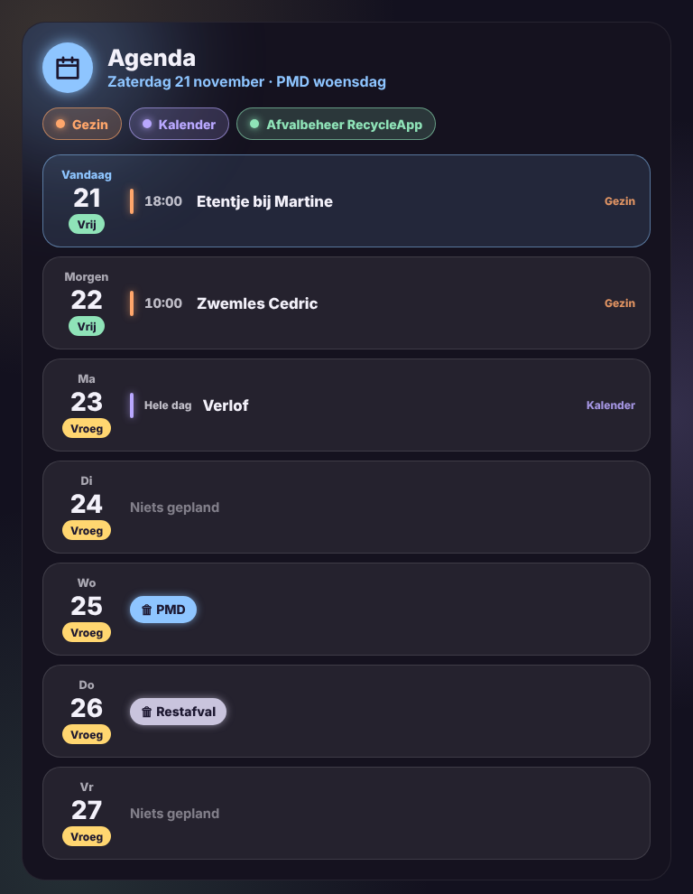

# Glow Calendar Card

🇬🇧 [English](calendar.md) · 🇳🇱 Nederlands



De komende dagen uit je agenda's in één overzicht.

- **Per dag** je afspraken met uur (of "Hele dag"), in de kleur van de agenda.
- **Afvalophaling** als gekleurde tag: PMD blauw, GFT groen, papier geel, restafval grijs. De afvalagenda zoekt de kaart zelf (naam met afval, recycle, waste…), of je kiest ze bij `waste`.
- **Ploeg**: met [Glow Schedules](https://github.com/stijnleroy/glow-schedules) staat onder elke dag de ploeg (vroeg, laat, vrij).
- **Bovenaan** de eerstvolgende ophaling, en chips om agenda's te verbergen.

```yaml
type: custom:glow-calendar-card
calendars:
  - calendar.icloud_gezin
  - entity: calendar.kalender
    name: Werk
    color: 255, 166, 107
waste: calendar.afvalbeheer_recycleapp
```

| Optie | Standaard | Uitleg |
|---|---|---|
| `calendars` | alle | Welke agenda's, als entity of met `name` en `color` (r, g, b). |
| `waste` | automatisch | Agenda('s) met de afvalophaling. |
| `days` | `7` | Aantal dagen. |
| `max` | `4` | Afspraken per dag, de rest als "+2 meer". |
| `shifts` | `true` | Ploeg van Glow Schedules tonen. |
| `glow` | `15` | Sterkte van de gloed. |
| `language` | automatisch | `nl`, `en`, `fr`, `de`, `es` of `it`. |
