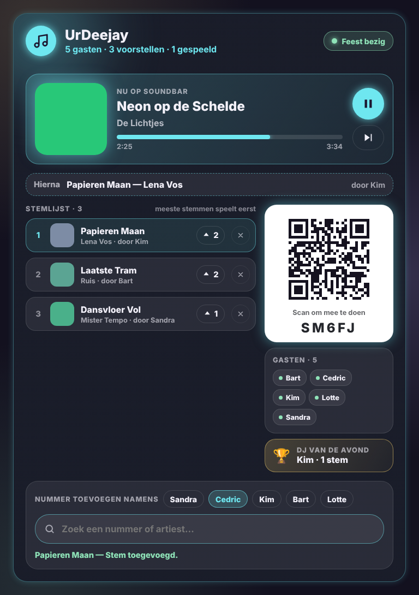

# Glow Deejay Card

🇬🇧 English · 🇳🇱 [Nederlands](deejay.nl.md)



Follow an [UrDeejay](https://github.com/stijnleroy/UrDeejay) party in Home Assistant, in the Glow style.

- **Now**: the song that is playing, with cover, who suggested it, progress and how many guests want to skip. Pause and skip from the card.
- **Up next**: the song that is already locked in.
- **Vote list**: all suggestions with their votes. Vote for a guest or remove a song.
- **QR code and party code** to join, who has joined (grey = idle for 10 minutes) and the DJ of the night.
- **Add a song**: pick a guest who joined, search and add. The TV screen then shows that guest's name.

The card talks to UrDeejay directly. Set a key in UrDeejay's `config.php` under `'ha_key'` (at least 16 characters) and use the same key in the card. The key can only follow and control the party, not change settings. An open card counts as an open screen in UrDeejay, so the list keeps running.

```yaml
type: custom:glow-deejay-card
url: https://urdeejay.example.com
key: your-ha-key
```

| Option | Default | Description |
|---|---|---|
| `url` | – | UrDeejay address. |
| `key` | – | The `ha_key` from `config.php`. |
| `title` | UrDeejay | Title. |
| `qr` | `true` | Show the QR code. |
| `compact` | `false` | Without vote list, guests and QR code. |
| `poll` | `3` | Refresh interval in seconds during a party. |
| `glow` | `15` | Glow strength. |
| `language` | automatic | `nl`, `en`, `fr`, `de`, `es` or `it`. |
