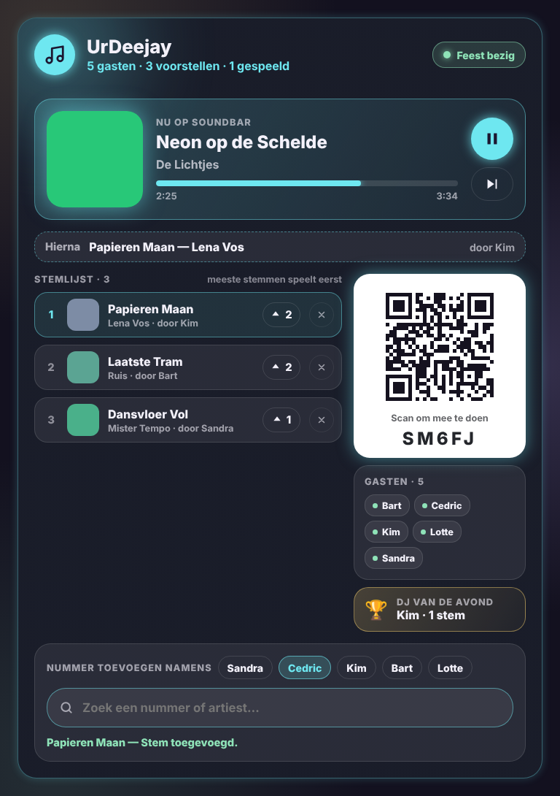

# Glow Deejay Card

🇬🇧 [English](deejay.md) · 🇳🇱 Nederlands



Volg een [UrDeejay](https://github.com/stijnleroy/UrDeejay)-feest in Home Assistant, in de Glow-stijl.

- **Nu**: het nummer dat speelt, met hoes, wie het voorstelde, de voortgang en hoeveel gasten willen overslaan. Pauzeren en overslaan kan van op de kaart.
- **Hierna**: het nummer dat al vastligt.
- **Stemlijst**: alle voorstellen met hun stemmen. Stem mee namens een gast of haal een nummer weg.
- **QR-code en feestcode** om mee te doen, wie er meedoet (grijs = de laatste 10 minuten niets gedaan) en de DJ van de avond.
- **Nummer toevoegen**: kies een gast die meedoet, zoek en voeg toe. Op het tv-scherm staat dan de naam van die gast.

De kaart praat rechtstreeks met UrDeejay. Zet daarvoor in `config.php` van UrDeejay een sleutel bij `'ha_key'` (minstens 16 tekens) en gebruik dezelfde sleutel in de kaart. Die sleutel kan alleen het feest volgen en bedienen, geen instellingen wijzigen. Een open kaart telt in UrDeejay als open scherm, zodat de lijst blijft lopen.

```yaml
type: custom:glow-deejay-card
url: https://urdeejay.drasticdesigns.be
key: jouw-ha-key
```

| Optie | Standaard | Uitleg |
|---|---|---|
| `url` | – | Adres van UrDeejay. |
| `key` | – | De `ha_key` uit `config.php`. |
| `title` | UrDeejay | Titel. |
| `qr` | `true` | QR-code tonen. |
| `compact` | `false` | Zonder stemlijst, gasten en QR-code. |
| `poll` | `3` | Om de hoeveel seconden de kaart vernieuwt tijdens een feest. |
| `glow` | `15` | Sterkte van de gloed. |
| `language` | automatisch | `nl`, `en`, `fr`, `de`, `es` of `it`. |
