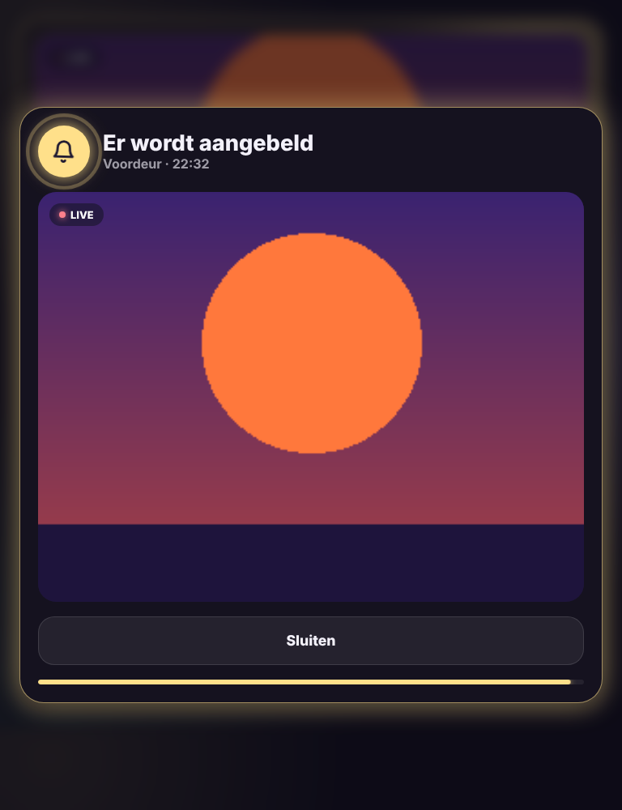

# Glow Doorbell Card

🇬🇧 English · 🇳🇱 [Nederlands](doorbell.nl.md)



Your doorbell in the Glow style, with a popup over the whole dashboard when someone rings.

- **Live video** from the doorbell camera. Tap it or **Watch live** to open it large.
- **Last rang**: when someone last rang. If it just happened, the card glows yellow.
- **Today**: what your cameras saw today, with the time: doorbell, person, vehicle, animal. The card finds those sensors itself (e.g. `binary_sensor.driveway_person`), or you pick them.
- **Popup when someone rings**: on every view of the dashboard a popup opens with a shaking bell and the live video. It closes by itself after 60 seconds.
- **Screen on**: if your tablet runs Fully Kiosk Browser with its JavaScript interface on, the card turns the screen on itself. Otherwise set `wake` to your tablet's screen switch.

The popup works on every view that has a Glow navigation bar or this card, so you only need the card on one view.

```yaml
type: custom:glow-doorbell-card
camera: camera.front_door
event: event.front_door_ring
wake: switch.tablet_screen
```

| Option | Default | Description |
|---|---|---|
| `camera` | – | Your doorbell camera. |
| `event` | automatic | The doorbell: an `event` entity (e.g. Nest, Reolink, Ring) or a binary sensor. |
| `name` | camera name | Name on the video. |
| `timeline` | automatic | Sensors for today's list. |
| `popup` | `true` | Show a popup when someone rings. |
| `popup_time` | `60` | Seconds before the popup closes. |
| `wake` | – | Switch or button that turns the tablet screen on. |
| `live` | `true` | Live video in the card (otherwise a snapshot every 5 seconds). |
| `glow` | `15` | Glow strength. |
| `language` | automatic | `en`, `nl`, `fr`, `de`, `es` or `it`. |
