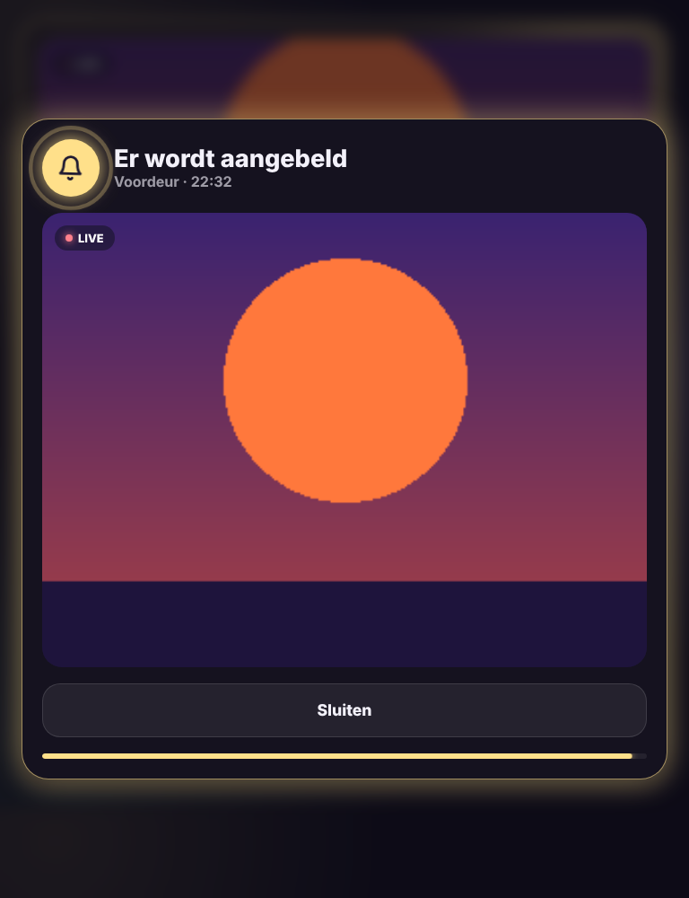

# Glow Doorbell Card

🇬🇧 [English](doorbell.md) · 🇳🇱 Nederlands



Je deurbel in de Glow-stijl, met een popup over het hele dashboard als er iemand aanbelt.

- **Live beeld** van de deurbelcamera. Tik erop of op **Live bekijken** om het groot te openen.
- **Laatst aangebeld**: wanneer er het laatst gebeld werd. Is het net gebeurd, dan gloeit de kaart geel.
- **Vandaag**: wat je camera's vandaag zagen, met het uur: aangebeld, persoon, voertuig, dier. De kaart zoekt die sensoren zelf (bv. `binary_sensor.opritcamera_persoon`), of je kiest ze.
- **Popup bij aanbellen**: op elke view van het dashboard springt een popup open met een schuddend belletje en het live beeld. Hij sluit vanzelf na 60 seconden.
- **Scherm aan**: draait je tablet Fully Kiosk Browser met de JavaScript-koppeling aan, dan zet de kaart het scherm zelf aan. Anders kies je bij `wake` de schermschakelaar van je tablet.

De popup werkt op elke view waar een Glow-navigatiebalk of deze kaart staat. Je hoeft de kaart dus maar op één view te zetten.

```yaml
type: custom:glow-doorbell-card
camera: camera.voordeur
event: event.voordeur_bel
wake: switch.tablet_scherm
```

| Optie | Standaard | Uitleg |
|---|---|---|
| `camera` | – | De camera van je deurbel. |
| `event` | automatisch | De deurbel: een `event`-entiteit (bv. Nest, Reolink, Ring) of een binaire sensor. |
| `name` | naam van de camera | Naam op het beeld. |
| `timeline` | automatisch | Sensoren voor de lijst van vandaag. |
| `popup` | `true` | Popup tonen bij aanbellen. |
| `popup_time` | `60` | Na hoeveel seconden de popup sluit. |
| `wake` | – | Schakelaar of knop die het scherm van de tablet aanzet. |
| `live` | `true` | Live beeld in de kaart (anders om de 5 seconden een foto). |
| `glow` | `15` | Sterkte van de gloed. |
| `language` | automatisch | `nl`, `en`, `fr`, `de`, `es` of `it`. |
