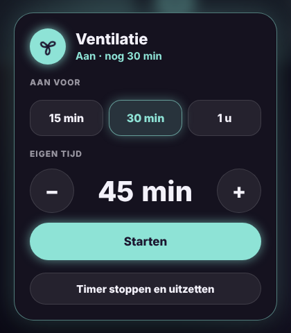

# Glow Fan Card

🇬🇧 English · 🇳🇱 [Nederlands](fan.nl.md)



A fan tile in the Glow style, for ventilation or a fan that simply turns on or off.

- **Tap**: on or off. While the fan is on, the icon spins, the tile glows and shows since when.
- **Double tap**: a popup with the timers (like the Glow Room Card).
- **Hold**: the standard details.
- **Timer buttons** (in the popup): turn the fan on for a set time, 15 min, 30 min and 1 h by default. The tile counts down and then turns the fan off. The popup then also shows **Stop timer and turn off**.
- **Other**: pick your own time with − and +, or a quick choice.

Works with `fan`, `switch`, `light` and `input_boolean` entities.

```yaml
type: custom:glow-fan-card
entity: fan.ventilation
name: Ventilation
timers: [15, 30, 60]
timer_entity: timer.ventilation
```

| Option | Default | Description |
|---|---|---|
| `entity` | – | The fan. |
| `name` | entity name | Name on the tile. |
| `icon` | spinning fan | Your own icon (does not spin). |
| `timers` | `[15, 30, 60]` | Timer buttons in minutes. An empty list `[]` hides the timer. |
| `custom` | `true` | **Other** button for your own time. |
| `timer_position` | `popup` | `popup`: the timers in a popup that opens with a double tap. `inside`: a two-row block on the right of the tile. `below`: a row of buttons below the tile. |
| `timer_entity` | – | A timer helper that handles switching off in Home Assistant (recommended, see below). |
| `color` | mint | Glow colour, e.g. `'#8EE3D6'`. |
| `glow` | `15` | Glow strength in pixels. |
| `language` | automatic | `en`, `nl`, `fr`, `de`, `es` or `it`. |

## Timer without or with a helper

**Without `timer_entity`** the tablet itself remembers when time is up and then turns the fan off. That works as long as the dashboard is open somewhere, which is usually the case with a wall tablet.

**With `timer_entity`** Home Assistant handles it, even when the tablet is off or reloads. Create once:

1. A timer helper: **Settings → Devices & services → Helpers → Create helper → Timer**, e.g. `timer.ventilation`.
2. An automation that turns the fan off when the timer finishes:

```yaml
alias: Ventilation off after timer
triggers:
  - trigger: event
    event_type: timer.finished
    event_data:
      entity_id: timer.ventilation
actions:
  - action: homeassistant.turn_off
    target:
      entity_id: fan.ventilation
```

If you turn the fan off by hand, the card stops the timer too.
