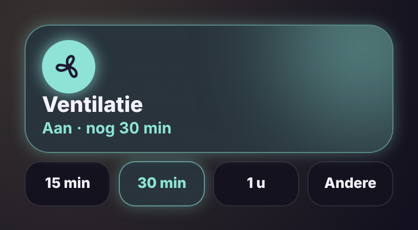

# Glow Fan Card

🇬🇧 [English](fan.md) · 🇳🇱 Nederlands



Een ventilatortegel in de Glow-stijl, voor een ventilatie of ventilator die gewoon aan of uit gaat.

- **Tik**: aan of uit. Als de ventilator aan staat, draait het icoon, gloeit de tegel en zie je sinds wanneer.
- **Lang drukken**: de gewone details.
- **Timerknoppen**: zet de ventilator aan voor een vaste tijd, standaard 15 min, 30 min en 1 u. De tegel telt af en daarna gaat de ventilator vanzelf uit. Tik nog eens op de actieve knop om te stoppen.
- **Andere**: kies zelf een tijd met − en +, of met een snelkeuze.

Werkt met `fan`-, `switch`-, `light`- en `input_boolean`-entiteiten.

```yaml
type: custom:glow-fan-card
entity: fan.ventilatie_stopcontact_1
name: Ventilatie
timers: [15, 30, 60]
timer_entity: timer.ventilatie
```

| Optie | Standaard | Uitleg |
|---|---|---|
| `entity` | – | De ventilator. |
| `name` | naam van de entiteit | Naam op de tegel. |
| `icon` | draaiende ventilator | Eigen icoon (draait dan niet). |
| `timers` | `[15, 30, 60]` | Timerknoppen in minuten. Een lege lijst `[]` verbergt de timer. |
| `custom` | `true` | Knop **Andere** voor een eigen tijd. |
| `timer_entity` | – | Een timer-helper die het uitschakelen in Home Assistant regelt (aanbevolen, zie hieronder). |
| `color` | mint | Gloedkleur, bv. `'#8EE3D6'`. |
| `glow` | `15` | Sterkte van de gloed in pixels. |
| `language` | automatisch | `nl`, `en`, `fr`, `de`, `es` of `it`. |

## Timer zonder of met helper

**Zonder `timer_entity`** onthoudt de tablet zelf wanneer de tijd om is en zet dan de ventilator uit. Dat werkt zolang het dashboard ergens open staat, wat bij een wandtablet meestal zo is.

**Met `timer_entity`** regelt Home Assistant het zelf, ook als de tablet uit staat of herlaadt. Maak daarvoor eenmalig:

1. Een timer-helper: **Instellingen → Apparaten & diensten → Helpers → Helper maken → Timer**, bv. `timer.ventilatie`.
2. Een automatisering die de ventilator uitzet als de timer afloopt:

```yaml
alias: Ventilatie uit na timer
triggers:
  - trigger: event
    event_type: timer.finished
    event_data:
      entity_id: timer.ventilatie
actions:
  - action: homeassistant.turn_off
    target:
      entity_id: fan.ventilatie_stopcontact_1
```

Zet je de ventilator met de hand uit, dan stopt de kaart ook de timer.
