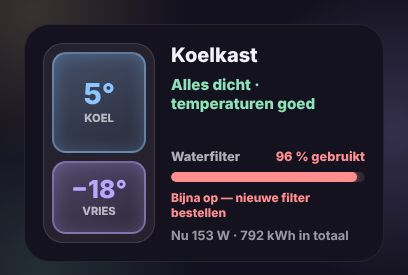

# Glow Fridge Card

🇬🇧 English · 🇳🇱 [Nederlands](fridge.nl.md)



The fridge as a tile, the size of the salt and battery tiles.

- **A drawn fridge** with the fridge and freezer temperatures.
- **Door open**: the compartment shows "OPEN"; open longer than `door_minutes` and it blinks red and moves to the top line.
- **Too warm**: above `fridge_max` or `freezer_max` the card warns.
- **Water filter** as a bar, "Almost used up" from 85 %.

```yaml
type: custom:glow-fridge-card
fridge: sensor.family_hub_koelkasttemperatuur
freezer: sensor.family_hub_freezer_temperature
fridge_door: binary_sensor.family_hub_cooler_door
freezer_door: binary_sensor.family_hub_freezer_door
filter: sensor.family_hub_water_filter_usage
power: sensor.family_hub_vermogen
```

| Option | Default | Description |
|---|---|---|
| `fridge` / `freezer` | – | Temperature sensors. |
| `fridge_door` / `freezer_door` | – | Door sensors. |
| `filter` | – | Water filter in %. |
| `filter_used` | `true` | The filter value is "used" (`false` if it is "left"). |
| `power` / `energy` | – | Power and energy, at the bottom. |
| `door_minutes` | `2` | Warn after this many minutes open. |
| `fridge_max` / `freezer_max` | `7` / `-15` | Too warm above. |
| `glow` | `15` | Glow strength. |
| `language` | automatic | `nl`, `en`, `fr`, `de`, `es` or `it`. |
