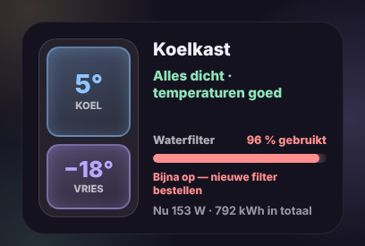

# Glow Fridge Card

🇬🇧 [English](fridge.md) · 🇳🇱 Nederlands



De koelkast als tegel, even groot als de zout- en batterijtegel.

- **Getekende koelkast** met de temperatuur van koel- en vriesvak.
- **Deur open**: het vak toont "OPEN"; staat een deur langer dan `door_minutes` open, dan knippert het vak rood en staat het bovenaan.
- **Te warm**: boven `fridge_max` of `freezer_max` waarschuwt de kaart.
- **Waterfilter** als balk, met "Bijna op" vanaf 85 %.

```yaml
type: custom:glow-fridge-card
fridge: sensor.family_hub_koelkasttemperatuur
freezer: sensor.family_hub_freezer_temperature
fridge_door: binary_sensor.family_hub_cooler_door
freezer_door: binary_sensor.family_hub_freezer_door
filter: sensor.family_hub_water_filter_usage
power: sensor.family_hub_vermogen
```

| Optie | Standaard | Uitleg |
|---|---|---|
| `fridge` / `freezer` | – | Temperatuursensoren. |
| `fridge_door` / `freezer_door` | – | Deursensoren. |
| `filter` | – | Waterfilter in %. |
| `filter_used` | `true` | De filterwaarde is "gebruikt" (zet op `false` als ze "over" is). |
| `power` / `energy` | – | Vermogen en energie, onderaan. |
| `door_minutes` | `2` | Waarschuwen na zoveel minuten open. |
| `fridge_max` / `freezer_max` | `7` / `-15` | Te warm boven. |
| `glow` | `15` | Sterkte van de gloed. |
| `language` | automatisch | `nl`, `en`, `fr`, `de`, `es` of `it`. |
