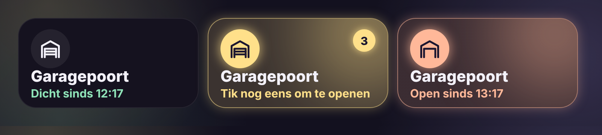

# Glow Garage Card

🇬🇧 English · 🇳🇱 [Nederlands](garage.nl.md)



A garage door tile in the Glow style.

- **Closed**: a calm tile with mint text, e.g. "Closed since 12:17".
- **Open**: the tile glows peach, so you can see from across the room that the door is open.
- **Operate**: tap once and the tile asks for confirmation ("Tap again to open") with a short countdown. Only a second tap within that time opens or closes the door, so it never opens by accident.
- **Hold**: the standard details.

Works with a `cover` (open/closed) or a `switch` / `input_boolean` (on = open).

```yaml
type: custom:glow-garage-card
entity: cover.garage_door
```

| Option | Default | Description |
|---|---|---|
| `entity` | – | The garage door. |
| `name` | entity name | Name on the tile. |
| `confirm` | `true` | Confirm with a second tap. |
| `confirm_time` | `3` | Seconds for the second tap. |
| `glow` | `15` | Glow strength in pixels. |
| `language` | automatic | `en`, `nl`, `fr`, `de`, `es` or `it`. |
