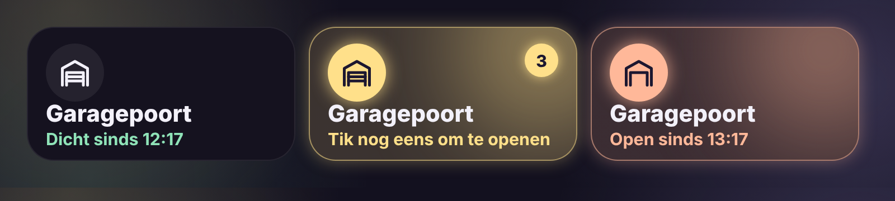

# Glow Garage Card

🇬🇧 [English](garage.md) · 🇳🇱 Nederlands



Een garagepoorttegel in de Glow-stijl.

- **Dicht**: een rustige tegel met mintgroene tekst, bv. "Dicht sinds 12:17".
- **Open**: de tegel gloeit perzik, zodat je van ver ziet dat de poort open staat.
- **Bedienen**: tik één keer en de tegel vraagt om bevestiging ("Tik nog eens om te openen") met een korte aftelling. Pas een tweede tik binnen die tijd opent of sluit de poort. Zo gaat ze niet per ongeluk open.
- **Lang drukken**: de gewone details.

Werkt met een `cover` (open/dicht) of een `switch` / `input_boolean` (aan = open).

```yaml
type: custom:glow-garage-card
entity: cover.garagepoort
```

| Optie | Standaard | Uitleg |
|---|---|---|
| `entity` | – | De garagepoort. |
| `name` | naam van de entiteit | Naam op de tegel. |
| `confirm` | `true` | Bevestigen met een tweede tik. |
| `confirm_time` | `3` | Seconden voor de tweede tik. |
| `glow` | `15` | Sterkte van de gloed in pixels. |
| `language` | automatisch | `nl`, `en`, `fr`, `de`, `es` of `it`. |
