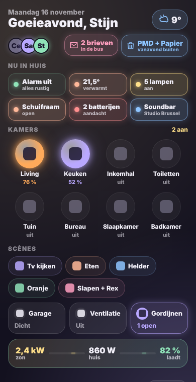

# Glow Home Card

🇬🇧 English · 🇳🇱 [Nederlands](home.nl.md)

The whole house on one phone screen, no sideways swiping.

- **Greeting and weather** on one line.
- **Who is where**: one bubble per person in the colour of where they are (green home, purple in a zone, grey away). Tap for details.
- **Mail and waste**: only shown when there is mail or the bins go out today or tomorrow.
- **Right now**: a grid of up to 6 chips with what needs attention: alarm, heating, lights on, open doors/windows, batteries that need attention, what is playing. Tap to open the view (`beveiliging`, `klimaat`, `verlichting`, `batterijen`, `media`).
- **Rooms as glowing orbs**: 4 per row, glowing in the colour of the light. Tap = on/off, long press = details.
- **Scenes** as buttons that wrap onto the next row.
- **Quick buttons** (garage, fan, blinds…). A garage door asks for a second tap.
- **Energy bar**: solar → home → battery (or grid). Tap to open `energie`.

See the [Dutch page](home.nl.md) for an example and all options (`name`, `persons`, `weather`, `alarm`, `climate`, `mail`, `waste`, `openings`, `media`, `links`, `rooms`, `scenes`, `quick`, `energy`, `glow`).
