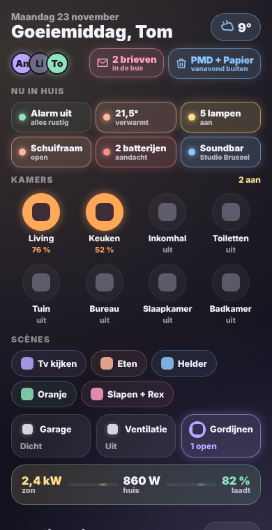

# Glow Home Card

🇬🇧 [English](home.md) · 🇳🇱 Nederlands



Het hele huis op één gsm-scherm, zonder opzij te vegen.

- **Begroeting en weer** op één regel.
- **Wie is waar**: een bolletje per persoon in de kleur van waar die is (groen thuis, paars in een zone, grijs weg). Tik voor de details.
- **Post en afval**: verschijnen alleen als er post is of als het afval vandaag of morgen buiten moet.
- **Nu in huis**: een raster van max. 6 chips met wat aandacht vraagt: alarm, verwarming, lampen aan, open ramen/deuren, batterijen die aandacht vragen, wat er speelt. Tik om naar de view te gaan (`beveiliging`, `klimaat`, `verlichting`, `batterijen`, `media`).
- **Kamers als lichtbollen**: 4 per rij, gloeiend in de kleur van het licht. Tik = aan/uit, lang drukken = details.
- **Scènes** als knoppen die doorlopen op een volgende rij.
- **Snelknoppen** (garage, ventilatie, gordijnen…). Een garagepoort vraagt een tweede tik.
- **Energiebalk**: zon → huis → batterij (of net). Tik om naar `energie` te gaan.

```yaml
type: custom:glow-home-card
name: Tom
mail: counter.post_in_de_brievenbus
openings: [binary_sensor.voordeur_contact, binary_sensor.schuifraam_contact]
rooms:
  - entity: light.verlichting_living
    name: Living
    icon: hue:room-living
  - light.keukenverlichting
scenes:
  - entity: scene.tv_kijken
    icon: mdi:television
quick:
  - entity: cover.garagepoort
  - entity: fan.ventilatie
  - entity: [cover.raam_links, cover.raam_rechts]
    name: Gordijnen
    icon: mdi:roller-shade
energy:
  solar: sensor.pv_vermogen
  grid: sensor.p1_vermogen
  battery: sensor.batterij_vermogen
  battery_soc: sensor.batterij_procent
```

| Optie | Uitleg |
|---|---|
| `name` | Naam in de begroeting. |
| `persons`, `weather`, `alarm`, `climate` | Leeg = automatisch. |
| `mail` | Postteller (verschijnt vanaf 1). |
| `waste` | Afvalsensoren met `days_until` of `sort_date` (leeg = automatisch). |
| `openings` | Deuren/ramen voor de chip "open". |
| `media` | Spelers voor de chip "speelt" (leeg = alle). |
| `links` | Andere views per chip, bv. `{ climate: thermostaat }`, of `false` voor de details. |
| `rooms` | Lampen of groepen: `entity`, `name`, `icon`, `color`. |
| `scenes` | Scènes of scripts: `entity`, `name`, `icon`, `color`. |
| `quick` | Max. 6 snelknoppen: `entity` (of een lijst), `name`, `icon`, `confirm`, `timer`, `navigate`. |
| `energy` | `solar`, `grid`, `battery`, `battery_soc`, `house`, `invert_grid`, `invert_battery`, `navigate`. |
| `glow` | Sterkte van de gloed (standaard 14). |
