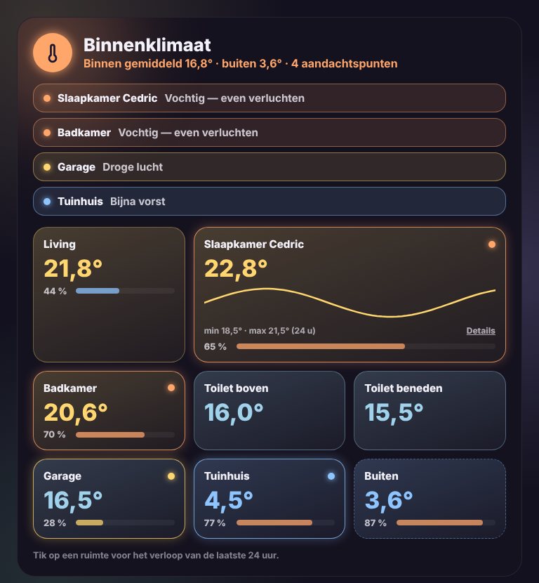

# Glow Indoor Card

🇬🇧 English · 🇳🇱 [Nederlands](indoor.nl.md)



Temperature and humidity of every room in one card.

- **Tiles** coloured from cold (blue) to warm (orange), humidity as a bar.
- **Warnings** at the top: humid (air the room), very humid, dry air, near freezing.
- **Tap** a room for the last 24 hours; "Details" opens the normal graph.
- A room with `outside: true` is left out of warnings and the average; `average: false` only leaves it out of the average.

```yaml
type: custom:glow-indoor-card
rooms:
  - name: Living
    temperature: sensor.living_temperatuur
    humidity: sensor.living_vochtigheid
  - name: Tuinhuis
    temperature: sensor.tuinhuis_temperature
    average: false
  - name: Buiten
    temperature: sensor.temperatuur
    outside: true
```

| Option | Default | Description |
|---|---|---|
| `rooms` | – | Rooms with `name`, `temperature`, `humidity`, `outside`, `average`. |
| `humid_high` | `65` | Humid from (%). |
| `humid_low` | `30` | Dry below (%). |
| `frost` | `5` | Frost warning below (°C). |
| `columns` | `3` | Columns (always 2 on a phone). |
| `glow` | `15` | Glow strength. |
| `language` | automatic | `nl`, `en`, `fr`, `de`, `es` or `it`. |
