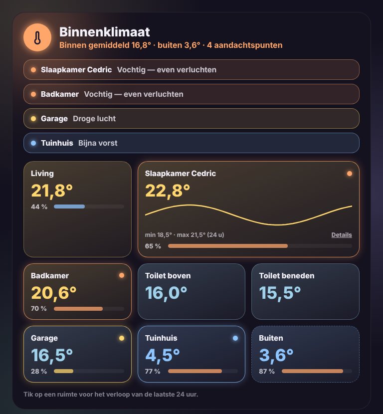

# Glow Indoor Card

🇬🇧 [English](indoor.md) · 🇳🇱 Nederlands



Temperatuur en luchtvochtigheid van alle ruimtes in één kaart.

- **Tegels** gekleurd van koud (blauw) naar warm (oranje), met de vochtigheid als balkje.
- **Aandachtspunten** bovenaan: vochtig (verluchten), erg vochtig, droge lucht, bijna vorst.
- **Tik** op een ruimte voor het verloop van de laatste 24 uur; "Details" opent de gewone grafiek.
- Een ruimte met `outside: true` telt niet mee voor waarschuwingen of het gemiddelde; met `average: false` telt een ruimte (bv. tuinhuis) niet mee voor het gemiddelde.

```yaml
type: custom:glow-indoor-card
rooms:
  - name: Living
    temperature: sensor.living_temperatuur
    humidity: sensor.living_vochtigheid
  - name: Tuinhuis
    temperature: sensor.tuinhuis_temperature
    average: false
  - name: Buiten
    temperature: sensor.temperatuur
    outside: true
```

| Optie | Standaard | Uitleg |
|---|---|---|
| `rooms` | – | Ruimtes met `name`, `temperature`, `humidity`, `outside`, `average`. |
| `humid_high` | `65` | Vochtig vanaf (%). |
| `humid_low` | `30` | Droog onder (%). |
| `frost` | `5` | Vorstwaarschuwing onder (°C). |
| `columns` | `3` | Kolommen (op een gsm altijd 2). |
| `glow` | `15` | Sterkte van de gloed. |
| `language` | automatisch | `nl`, `en`, `fr`, `de`, `es` of `it`. |
