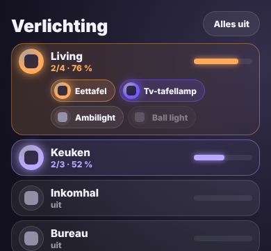

# Glow Lights Card

🇬🇧 [English](lights.md) · 🇳🇱 Nederlands



Verlichting voor de gsm: één regel per kamer.

- **Lichtbol** links: tik om de kamer aan of uit te zetten, lang drukken voor de details.
- **Balk** rechts: sleep om de helderheid te kiezen.
- **Tik op de naam** om de lampen van die kamer open te klappen en apart te schakelen.
- **Alles uit** bovenaan.

```yaml
type: custom:glow-lights-card
rooms:
  - entity: light.verlichting_living
    name: Living
    icon: hue:room-living
    lights: [light.eettafel, light.tv_lamp]
  - light.keukenverlichting
```

Opties: `title` (of `false`), `rooms` (`entity`, `name`, `icon`, `color`, `lights`), `open` (welke kamer open staat, vanaf 0), `glow`.
