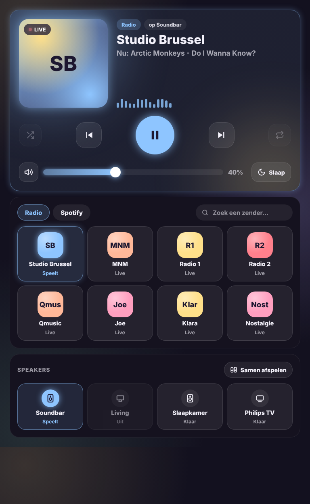

# Glow Media Card

🇬🇧 English · 🇳🇱 [Nederlands](media.nl.md)



A large media card for its own view on your tablet: what is playing, internet radio, Spotify and your speakers, in the Glow style.

- **Now playing**: large artwork, title, artist and progress. The whole card glows in the artwork's most striking colour, or in the station's colour.
- **Controls**: big play button, previous and next, shuffle and repeat (one or all), volume and mute. On radio, previous and next jump to the previous or next favourite station.
- **Radio**: your favourite stations as tiles. One tap plays the station on the chosen speaker, with a LIVE label and what is playing now. Search any station and tap the star to add it to your favourites.
- **Spotify**: your playlists. Tap one to play it on the chosen speaker, if Spotify knows that speaker (e.g. TV or soundbar).
- **Speakers**: pick where to play at the bottom. **Play together** lets you tick several speakers: players that can group are grouped, otherwise the same station also starts on the other speakers.
- **Sleep timer**: music stops by itself after 15, 30, 45 or 60 minutes.
- **Sound and source**: pick a sound mode or input when the player supports it.

Stations are looked up in [Radio Browser](https://www.radio-browser.info), the same open station list Home Assistant uses, so a station name is enough. Starred stations and the sleep timer are kept on the device itself (the tablet).

```yaml
type: custom:glow-media-card
entities:
  - media_player.soundbar
  - media_player.living_speaker
  - media_player.tv
stations:
  - Studio Brussel
  - MNM
  - name: My station
    url: https://stream.example.com/live.mp3
    logo: https://example.com/logo.png
```

| Option | Default | Description |
|---|---|---|
| `entities` | – | Your speakers and players. `{ entity: media_player.tv, name: TV, spotify_source: 'Living TV' }` works too. |
| `stations` | – | Favourite stations: a name, a link or `{ name, url, logo }`. |
| `spotify` | automatic | The Spotify player (`media_player.spotify_…`). `false` hides Spotify. |
| `layout` | `full` | `compact` for a small card with only what is playing. |
| `glow` | `15` | Glow strength. |
| `language` | automatic | `en`, `nl`, `fr`, `de`, `es` or `it`. |
