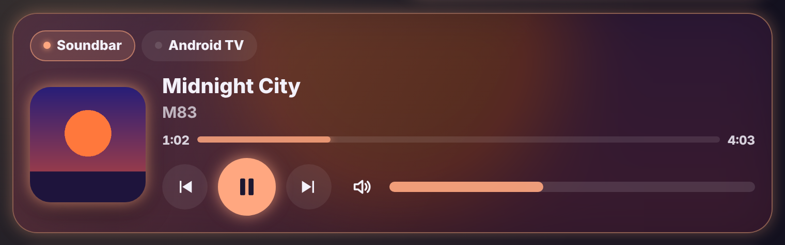

# Glow Media Card

🇬🇧 [English](media.md) · 🇳🇱 Nederlands



Wat er speelt op je tv, soundbar of speaker, in de Glow-stijl.

- **Hoes**: groot links, en wazig als achtergrond van de kaart.
- **Gloed in de kleur van de hoes**: de kaart haalt de opvallendste kleur uit de hoes en maakt ze pastel. Rand, knop en balkjes gloeien in die kleur.
- **Bediening**: vorige, afspelen/pauze en volgende, een volumebalk die je kunt slepen, en geluid uit. De kaart toont alleen de knoppen die de speler ondersteunt.
- **Voortgang**: een balkje met de verstreken en totale tijd.
- **Meerdere spelers**: geef er meer op, dan krijg je bovenaan knopjes om te wisselen. De kaart kiest vanzelf de speler die nu speelt, met een gloeiend bolletje.
- **Uit**: speelt er niets, dan staat er een aan/uit-knop.
- **Tik op de hoes**: de gewone details van de speler.

```yaml
type: custom:glow-media-card
entities:
  - media_player.soundbar
  - media_player.android_tv
```

| Optie | Standaard | Uitleg |
|---|---|---|
| `entities` | – | Lijst met mediaspelers. Ook `{ entity: media_player.tv, name: Tv }` kan. |
| `glow` | `15` | Sterkte van de gloed. |
| `language` | automatisch | `nl`, `en`, `fr`, `de`, `es` of `it`. |
