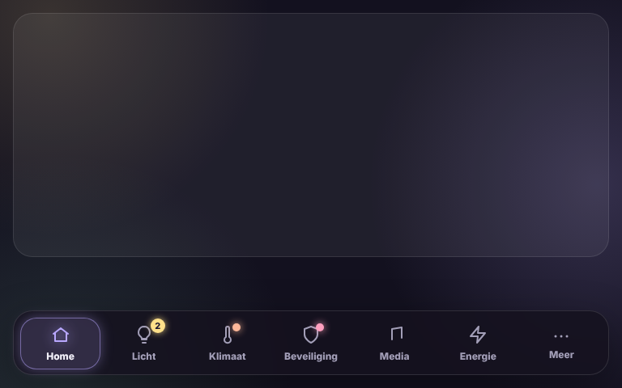

# Glow Navbar Card

🇬🇧 English · 🇳🇱 [Nederlands](navbar.nl.md)



A navigation bar at the bottom of the screen. Tap a view to go there; the active view glows in its colour. Views that don't fit go under **More**.

Add the card at the bottom of **every view** of the dashboard. The bar floats over the screen; the card itself only keeps some space free at the bottom so nothing is hidden behind it. Leave `views` out and the bar is filled automatically with the views of the dashboard.

```yaml
type: custom:glow-navbar-card
max_items: 6
views:
  - path: /dashboard-tablet/0
    name: Home
    icon: mdi:home
  - path: /dashboard-tablet/verlichting
    name: Lights
    icon: mdi:lightbulb
    badge:
      type: lights_on
  - path: /dashboard-tablet/klimaat
    name: Climate
    icon: mdi:thermometer
    badge:
      entity: climate.thermostaat
      attribute: hvac_action
      state: heating
  - path: /dashboard-tablet/beveiliging
    name: Security
    icon: mdi:shield-home
    badge:
      entity: alarm_control_panel.alarmo
      state_not: disarmed
```

| Option | Default | Description |
|---|---|---|
| `views` | automatic | List of views (below). Empty = all views of this dashboard. |
| `max_items` | `6` | Views on the bar; the rest goes under "More". |
| `labels` | `always` | `always`, `active` (only the active view) or `never`. |
| `style` | `floating` | `floating` or `fixed` (against the bottom edge). |
| `glow` | `15` | Glow strength in pixels. |
| `spacer` | `true` | Keep space free at the bottom of the view. |
| `language` | automatic | `en`, `nl`, `fr`, `de`, `es` or `it`. |

Per view: `path` (e.g. `/dashboard-tablet/klimaat`, or a full `https://` link), `name`, `icon`, `color` and optionally `badge`:

| Badge | Shows |
|---|---|
| `type: lights_on` | Number of lights that are on (groups not counted). |
| `type: count` + `entity` | The number of a sensor, when above 0. |
| `entity` + `state` | A dot when the state (or `attribute`) equals one of the values. |
| `entity` + `state_not` | A dot when the state is none of the values. |
| `entity` alone | A dot when the state is on, open, heating, home or playing. |
