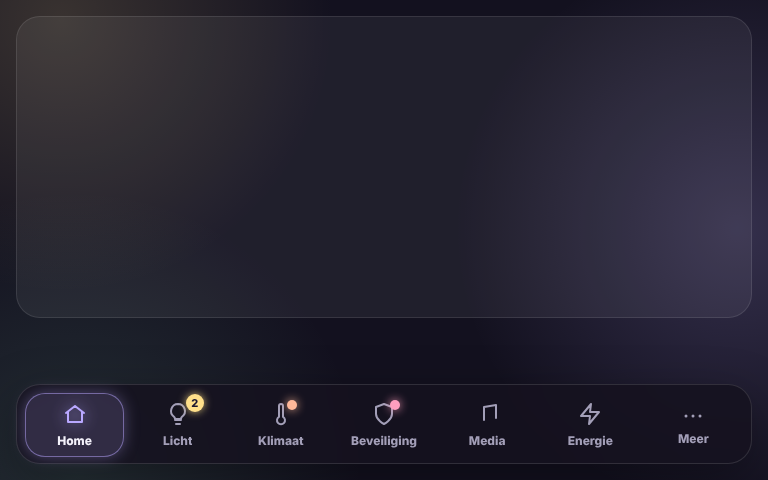

# Glow Navbar Card

🇬🇧 [English](navbar.md) · 🇳🇱 Nederlands



Een navigatiebalk onderaan het scherm. Tik op een view om erheen te gaan; de actieve view gloeit in zijn kleur. Views die niet passen, staan onder **Meer**.

Zet de kaart onderaan **elke view** van het dashboard. De balk zweeft over het scherm; de kaart zelf houdt onderaan alleen wat ruimte vrij zodat niets erachter verdwijnt. Laat je `views` weg, dan vult de balk zich vanzelf met de views van het dashboard.

### Maar één keer instellen

Stel de balk volledig in op één view, bv. de eerste. Zet op alle andere views een lege kaart:

```yaml
type: custom:glow-navbar-card
```

Een lege kaart neemt automatisch de instellingen over van de eerste navigatiebalk in het dashboard die wel ingesteld is. Een aanpassing doe je dan maar op één plek. Geef je een kaart toch eigen instellingen, dan gebruikt die kaart enkel haar eigen instellingen.

```yaml
type: custom:glow-navbar-card
max_items: 6
views:
  - path: /dashboard-tablet/0
    name: Home
    icon: mdi:home
  - path: /dashboard-tablet/verlichting
    name: Licht
    icon: mdi:lightbulb
    badge:
      type: lights_on
  - path: /dashboard-tablet/klimaat
    name: Klimaat
    icon: mdi:thermometer
    badge:
      entity: climate.thermostaat
      attribute: hvac_action
      state: heating
  - path: /dashboard-tablet/beveiliging
    name: Beveiliging
    icon: mdi:shield-home
    badge:
      entity: alarm_control_panel.alarmo
      state_not: disarmed
```

| Optie | Standaard | Uitleg |
|---|---|---|
| `views` | automatisch | Lijst met views (zie hieronder). Leeg = alle views van dit dashboard. |
| `max_items` | `6` | Aantal views op de balk; de rest komt onder "Meer". |
| `labels` | `always` | `always`, `active` (alleen de actieve view) of `never`. |
| `style` | `floating` | `floating` (zwevend) of `fixed` (tegen de onderrand). |
| `glow` | `15` | Sterkte van de gloed in pixels. |
| `spacer` | `true` | Onderaan de view ruimte vrijhouden. |
| `language` | automatisch | `nl`, `en`, `fr`, `de`, `es` of `it`. |

Per view: `path` (bv. `/dashboard-tablet/klimaat`, of een volledige `https://`-link), `name`, `icon`, `color` en eventueel `badge`:

| Bolletje | Toont |
|---|---|
| `type: lights_on` | Aantal lampen die aan staan (groepen tellen niet mee). |
| `type: count` + `entity` | Het getal van een sensor, als het boven 0 is. |
| `entity` + `state` | Een stip als de status (of het `attribute`) gelijk is aan een van de waarden. |
| `entity` + `state_not` | Een stip als de status geen van de waarden is. |
| alleen `entity` | Een stip als de status on, open, heating, home of playing is. |
