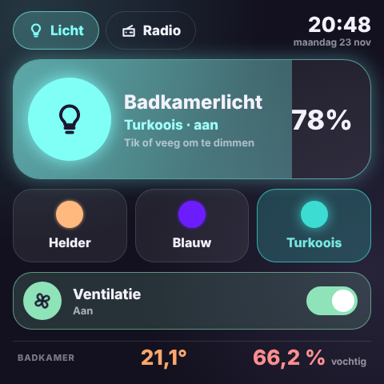

# Glow Panel Card

🇬🇧 English · 🇳🇱 [Nederlands](panel.nl.md)

One square screen for a wall panel such as an NSPanel Pro (480×480). Everything you touch sits at the top; the bottom only shows information. Handy when the bottom of the touchscreen is less responsive.

- **Light:** a big bar. Tap the lamp to toggle, tap or swipe the bar to dim.
- **Scenes:** big named buttons, plus **Colour…** to pick a white tone or colour. The light follows right away.
- **Fan:** a wide switch, with a warning when it is humid.
- **Radio** (optional): what is playing, volume, stop and up to 6 stations.
- **Bottom:** temperature and humidity.

See the [Dutch page](panel.nl.md) for a full YAML example; all options are the same. Put the card in a **Panel** view so it fills the screen.

| Option | Description |
|---|---|
| `light` | The light (required). |
| `scenes` | Scenes as buttons: an entity, or `entity`, `name` and `color` (`r, g, b`). |
| `fan` | Fan or switch. |
| `temperature`, `humidity` | Sensors at the bottom. |
| `humidity_threshold` | Humidity % from which the card warns (default 65). |
| `area` | Name at the bottom left. |
| `media_player`, `stations` | Radio: per station `name`, optionally `image` or `color`, and `script` or `media_content_id` (+ `media_content_type`). |
| `name` | Other name for the light. |
| `height`, `radius` | Height (default 100 %) and rounded corners. |
| `glow`, `language` | Glow and language. |
