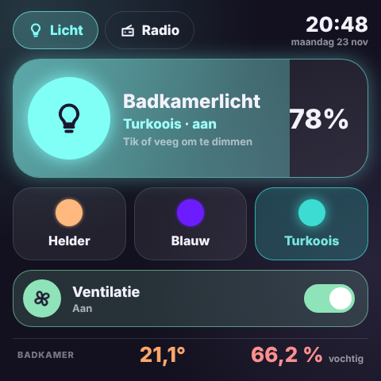

# Glow Panel Card

🇬🇧 [English](panel.md) · 🇳🇱 Nederlands



Eén vierkant scherm voor een wandpaneel, zoals een NSPanel Pro (480×480). Alles wat je aanraakt staat bovenaan, onderaan staat alleen informatie. Handig als het scherm onderaan minder goed reageert.

- **Licht:** een grote balk. Tik op de lamp voor aan/uit, tik of veeg over de balk om te dimmen.
- **Scènes:** grote knoppen met naam, en **Kleur…** om zelf een wittint of kleur te kiezen. Het licht volgt meteen.
- **Ventilatie:** brede schakelaar, met een waarschuwing als het vochtig is.
- **Radio** (optioneel): wat er speelt, volume, stop en tot 6 zenders.
- **Onderaan:** temperatuur en vochtigheid.

```yaml
type: custom:glow-panel-card
light: light.badkamerlicht
scenes:
  - entity: scene.badkamer_helder
    name: Helder
    color: 255, 184, 125
  - scene.badkamer_blauw
fan: fan.ventilatie
temperature: sensor.badkamer_temperatuur
humidity: sensor.badkamer_vochtigheid
area: Badkamer
media_player: media_player.paneel
stations:
  - name: MNM
    script: script.radio_mnm
  - name: Top Radio
    image: /local/topradio.jpeg
    media_content_id: media-source://radio_browser/…
    media_content_type: audio/mpeg
```

Zet de kaart in een view van het type **Paneel** zodat ze het hele scherm vult.

| Optie | Uitleg |
|---|---|
| `light` | De lamp (verplicht). |
| `scenes` | Scènes als knoppen: een entiteit, of `entity`, `name` en `color` (`r, g, b`). |
| `fan` | Ventilator of schakelaar. |
| `temperature`, `humidity` | Sensoren onderaan. |
| `humidity_threshold` | Vanaf welk vochtpercentage de kaart waarschuwt (standaard 65). |
| `area` | Naam links onderaan. |
| `media_player`, `stations` | Radio: per zender `name`, eventueel `image` of `color`, en `script` of `media_content_id` (+ `media_content_type`). |
| `name` | Andere naam voor de lamp. |
| `height`, `radius` | Hoogte (standaard 100 %) en afgeronde hoeken. |
| `glow`, `language` | Gloed en taal. |
