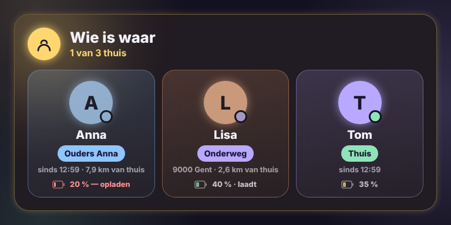

# Glow People Card

🇬🇧 English · 🇳🇱 [Nederlands](people.nl.md)



Who is where, in the Glow style.

- **Per person**: home, in a zone (Work, School…) or away, and since when.
- **Away**: the town from the phone and how far from home.
- **Phone battery**; red with "charge" below `low`, "charging" when plugged in.
- The card finds the phone itself through the person's source (Companion app).

```yaml
type: custom:glow-people-card
entities:
  - person.tom
  - entity: person.anna
    color: 255, 166, 107
```

| Option | Default | Description |
|---|---|---|
| `entities` | everyone | People, optionally with `name`, `color`, `picture`, `battery`. |
| `low` | `20` | Battery low below (%). |
| `glow` | `15` | Glow strength. |
| `language` | automatic | `nl`, `en`, `fr`, `de`, `es` or `it`. |
