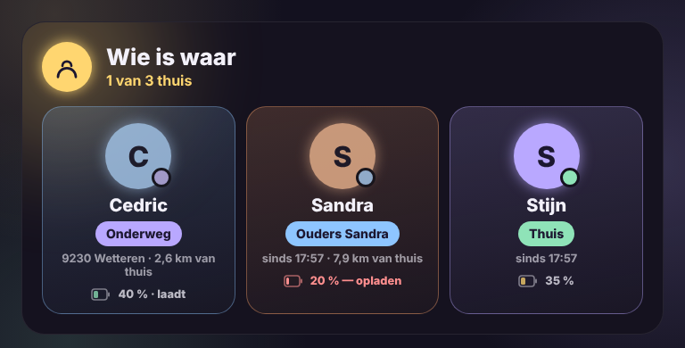

# Glow People Card

🇬🇧 [English](people.md) · 🇳🇱 Nederlands



Wie is waar, in de Glow-stijl.

- **Per persoon**: thuis, in een zone (Werk, School…) of onderweg, en sinds wanneer.
- **Onderweg**: de gemeente uit de gsm en hoe ver van thuis.
- **Batterij** van de gsm; rood met "opladen" onder `low`, "laadt" als de gsm aan de lader hangt.
- De gsm vindt de kaart zelf via de bron van de persoon (Companion-app).

```yaml
type: custom:glow-people-card
entities:
  - person.stijn
  - entity: person.sandra
    color: 255, 166, 107
```

| Optie | Standaard | Uitleg |
|---|---|---|
| `entities` | iedereen | Personen, eventueel met `name`, `color`, `picture`, `battery`. |
| `low` | `20` | Batterij laag onder (%). |
| `glow` | `15` | Sterkte van de gloed. |
| `language` | automatisch | `nl`, `en`, `fr`, `de`, `es` of `it`. |
