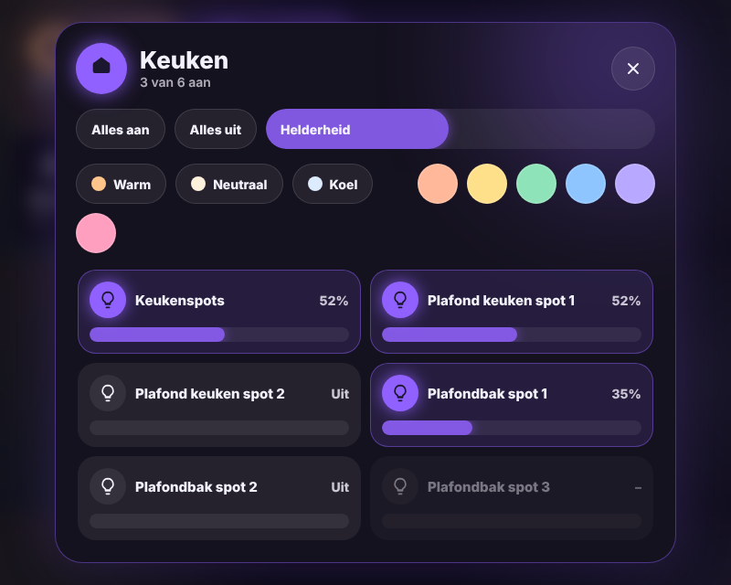

# Glow Room Card

🇬🇧 English · 🇳🇱 [Nederlands](room.nl.md)



A room tile in the Glow style. It glows in the colour of the lights that are on.

- **Tap**: toggle the room's lights.
- **Double tap**: open a popup with every light of the room: on/off, a brightness slider per light, a slider for the whole room, warm/neutral/cool and six pastel colours.
- **Hold**: open the standard details of the light or group.
- The popup closes when you tap outside it, with the ✕, or automatically after 30 seconds without touching it.

The lights in the popup are found automatically: the members of the light group (Home Assistant groups, Zigbee2MQTT groups), or the lights in the same area (for example a Hue room). You can also list them yourself.

```yaml
type: custom:glow-room-card
entity: light.verlichting_living
name: Living
icon: hue:room-living
```

| Option | Default | Description |
|---|---|---|
| `entity` | – | Light or light group of the room (tap toggles it). |
| `name` | entity name | Name on the tile. |
| `icon` | bulb | Any icon, also `hue:` or `fas:` icons. |
| `area` | – | Area whose lights appear in the popup. |
| `lights` | automatic | Your own list of lights for the popup. |
| `color` | `#FFD27A` | Glow colour when the lights report no colour. |
| `glow` | `22` | Glow strength in pixels. |
| `auto_close` | `30` | Close the popup after this many seconds (0 = never). |
| `language` | automatic | `en`, `nl`, `fr`, `de`, `es` or `it`. |
