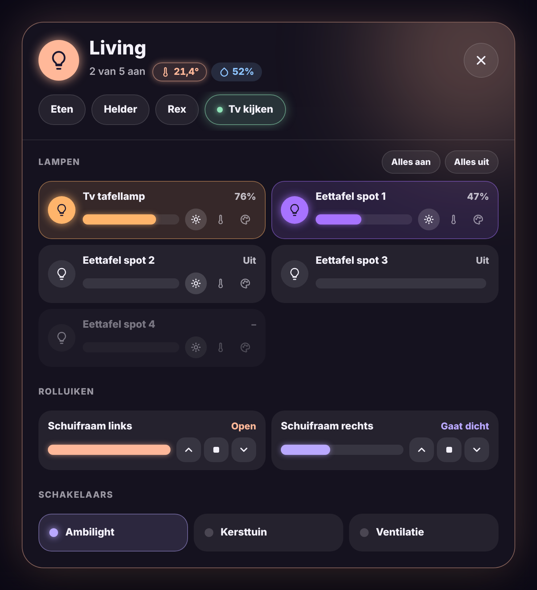

# Glow Room Card

🇬🇧 [English](room.md) · 🇳🇱 Nederlands



Een kamertegel in de Glow-stijl. Hij gloeit in de kleur van de lampen die aan staan.

- **Tik**: licht van de kamer aan/uit.
- **Dubbeltik**: popup met alles van de kamer (zie hieronder).
- **Lang drukken**: de gewone details van de lamp of groep.
- De popup sluit als je ernaast tikt, met het ✕, of vanzelf na 30 seconden zonder aanraking.

## De popup

De popup houdt altijd dezelfde warme gloed. Alleen de lamptegels kleuren mee met hun lamp.

- **Klimaat**: temperatuur en vochtigheid naast de naam. Het temperatuurbolletje gloeit als de thermostaat van de kamer aan het verwarmen is.
- **Scènes**: een rij knoppen bovenaan. De scène die nog klopt, gloeit.
- **Lampen**: per lamp aan/uit en een schuifbalk. Met de knopjes ernaast wissel je, zoals bij Mushroom, tussen helderheid ☀, kleurtemperatuur 🌡 en kleur 🎨. Je ziet alleen de knopjes die de lamp ondersteunt. Bovenaan staan **Alles aan** en **Alles uit**.
- **Rolluiken**: een schuifbalk voor de positie en knoppen voor open, stop en dicht.
- **Schakelaars**: stopcontacten, ventilatoren, helpers (`switch`, `fan`, `input_boolean`).

Alles wordt automatisch gezocht in de ruimte van de kaart: de ruimte die je bij `area` opgeeft, of anders de ruimte van de lamp of groep. Verborgen entiteiten en instellingsentiteiten worden overgeslagen. De lampen komen eerst uit de lampgroep (Home Assistant-groepen, Zigbee2MQTT-groepen), anders uit de ruimte.

Wil je het zelf bepalen, vul dan de lijsten in. Met `sections` kies je welke onderdelen in de popup komen, en in welke volgorde.

```yaml
type: custom:glow-room-card
entity: light.verlichting_living
name: Living
icon: hue:room-living
sections: [climate, scenes, lights, covers, switches]
scenes:
  - scene.tv_kijken
  - scene.eten
covers:
  - cover.schuifraam_links
  - cover.schuifraam_rechts
switches:
  - switch.ambilight
temperature: sensor.living_temperatuur
```

| Optie | Standaard | Uitleg |
|---|---|---|
| `entity` | – | Lamp of lampgroep van de kamer (tik schakelt die). |
| `name` | naam van de entiteit | Naam op de tegel. |
| `icon` | lampje | Eender welk icoon, ook `hue:`- of `fas:`-iconen. |
| `area` | ruimte van `entity` | Ruimte waaruit de popup zijn inhoud haalt. |
| `sections` | alles | Onderdelen van de popup: `climate`, `scenes`, `lights`, `covers`, `switches`. |
| `lights` | automatisch | Eigen lijst met lampen. |
| `scenes` | uit de ruimte | Eigen lijst met scènes. |
| `covers` | uit de ruimte | Eigen lijst met rolluiken. |
| `switches` | uit de ruimte | Eigen lijst met schakelaars. |
| `temperature` | uit de ruimte | Temperatuursensor. |
| `humidity` | uit de ruimte | Vochtigheidssensor. |
| `color` | `#FFD27A` | Gloedkleur van de tegel als de lampen geen kleur doorgeven. |
| `glow` | `22` | Sterkte van de gloed in pixels. |
| `auto_close` | `30` | Popup sluiten na zoveel seconden (0 = nooit). |
| `language` | automatisch | `nl`, `en`, `fr`, `de`, `es` of `it`. |

Alles kan ook in de visuele editor, onder **Inhoud van de popup**.

### Welke scène gloeit?

Net als bij de Glow Scene Card vergelijkt de popup de opgeslagen scène met de huidige toestand van de lampen (met 10% marge op de helderheid). Daarvoor moet het dashboard met een beheerdersaccount open staan. Zonder beheerdersrechten gloeit de laatst gestarte scène, zolang de lampen ervan niet meer veranderd zijn.

## Kom je van versie 1.5.0 of ouder?

De rijen warm/neutraal/koel, de kleurbolletjes en de helderheidsregelaar voor de hele kamer zijn weg. Kleurtemperatuur en kleur stel je nu per lamp in. Je hoeft niets aan je configuratie te veranderen.
