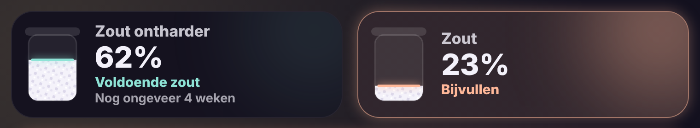

# Glow Salt Card

🇬🇧 English · 🇳🇱 [Nederlands](salt.nl.md)



The salt level of your water softener as a tile, the size of a room tile.

- **Salt tank**: the tank empties with the level, with a glowing line on top of the salt.
- **Colour**: mint while there is enough salt, peach with "Refill" below the warning level (25% by default), red with "Almost empty" below half of that.
- **Estimate**: the card looks at the sensor history to see how much salt is used per day since the last refill and shows "About 3 weeks left". With too little history it shows when you last refilled.
- **Tap**: the standard details with the graph.

Works with a sensor in **%** or with a **distance** (cm, mm, m) from the sensor to the salt. For a distance, set which distance means "empty" and which means "full".

```yaml
type: custom:glow-salt-card
entity: sensor.zout_niveau
```

| Option | Default | Description |
|---|---|---|
| `entity` | – | The salt sensor. |
| `name` | entity name | Name on the tile. |
| `low` | `25` | Warn below this percentage. |
| `empty_distance` | `50` | Distance (cm) when empty, only for a distance sensor. |
| `full_distance` | `5` | Distance (cm) when full. |
| `glow` | `15` | Glow strength. |
| `language` | automatic | `en`, `nl`, `fr`, `de`, `es` or `it`. |
