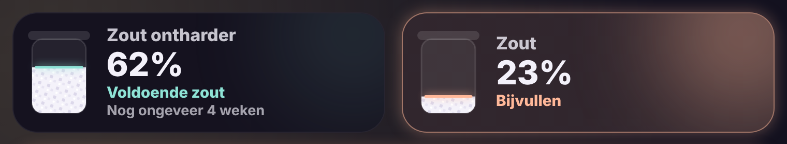

# Glow Salt Card

🇬🇧 [English](salt.md) · 🇳🇱 Nederlands



Het zoutniveau van je waterontharder als tegel, even groot als een kamertegel.

- **Vat met zout**: het vat loopt leeg met het niveau, met een gloeiend lijntje bovenaan het zout.
- **Kleur**: mint zolang er genoeg zout is, perzik met "Bijvullen" onder de waarschuwingsgrens (standaard 25%), rood met "Bijna leeg" onder de helft daarvan.
- **Schatting**: de kaart kijkt in de geschiedenis van de sensor hoeveel zout er sinds de laatste keer bijvullen per dag verdwijnt, en toont "Nog ongeveer 3 weken". Is er nog te weinig geschiedenis, dan staat er wanneer je het laatst bijvulde.
- **Tik**: de gewone details met de grafiek.

Werkt met een sensor in **%** of met een **afstand** (cm, mm, m) van de sensor tot het zout. Bij een afstand stel je in welke afstand "leeg" en welke "vol" is.

### Schatting op basis van regeneraties (kg)

Heb je geen sensor in het vat, maar een helper (`input_number`) in **kg** die een automatisering bij elke regeneratie verlaagt, dan werkt de kaart daar ook mee:

- **Kilo's en percentage**: het percentage rekent met de inhoud van het vat (`capacity`, anders het maximum van de helper).
- **Nog X regeneraties**: de kaart haalt uit de geschiedenis hoeveel zout er per regeneratie afgaat.
- **± weken**: hoe lang het zout nog meegaat bij het huidige tempo.
- **Laatste regeneratie**: wanneer de automatisering het laatst liep.
- **Knop Bijgevuld**: start je script om bij te vullen. Tik twee keer binnen 3 seconden, zodat je niet per ongeluk bijvult.

Het script en de automatisering zoekt de kaart zelf (namen met zout/waterverzachter en bijvullen/regeneratie). Je kan ze ook zelf kiezen.

```yaml
type: custom:glow-salt-card
entity: sensor.zout_niveau
```

```yaml
type: custom:glow-salt-card
entity: input_number.zout_waterverzachter
refill_script: script.waterverzachter_zout_bijvullen
regen_automation: automation.waterverzachter_zoutverbruik_op_basis_van_regeneratie
```

| Optie | Standaard | Uitleg |
|---|---|---|
| `entity` | – | De zoutsensor, of de helper met het zout in kg. |
| `name` | naam van de entiteit | Naam op de tegel. |
| `low` | `25` | Waarschuwen onder dit percentage. |
| `empty_distance` | `50` | Afstand (cm) als het vat leeg is, alleen bij een afstandssensor. |
| `full_distance` | `5` | Afstand (cm) als het vat vol is. |
| `capacity` | maximum van de helper | Inhoud van het vat in kg, alleen bij kg. |
| `refill_script` | automatisch | Script (of knop) om bij te vullen. |
| `regen_automation` | automatisch | Automatisering die bij een regeneratie zout aftrekt. |
| `glow` | `15` | Sterkte van de gloed. |
| `language` | automatisch | `nl`, `en`, `fr`, `de`, `es` of `it`. |
