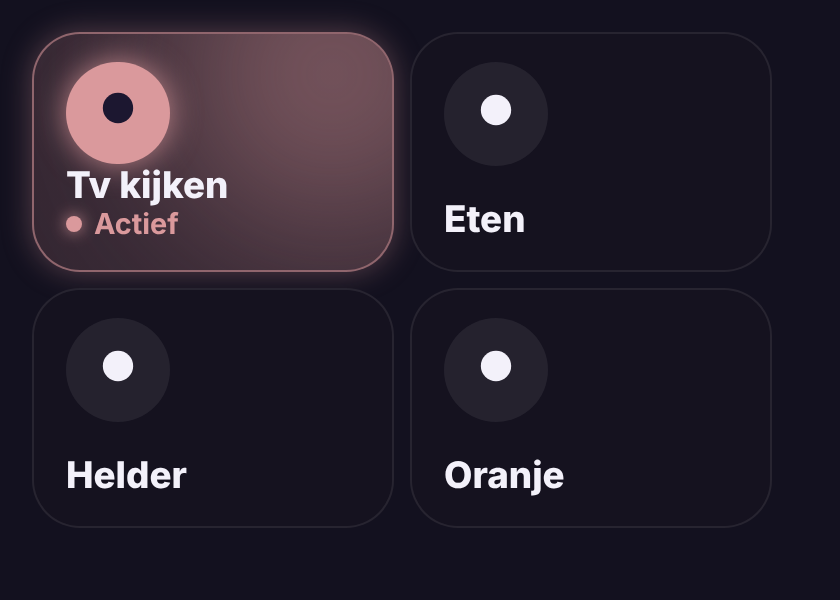

# Glow Scene Card

🇬🇧 English · 🇳🇱 [Nederlands](scene.nl.md)



A scene button that glows while the scene is **active**: the lights are still as the scene set them (on/off and brightness, within a small margin). Change a light by hand and the glow fades. When two scenes with the same lights both match, the most recently started one lights up.

- **Tap**: start the scene. **Hold**: details.
- Works best with scenes made in the scene editor and a dashboard user with administrator rights (the card reads the stored scene). Otherwise it falls back to: the last started scene glows until one of its lights changes.

```yaml
type: custom:glow-scene-card
entity: scene.tv_kijken
```

| Option | Default | Description |
|---|---|---|
| `entity` | – | The scene. |
| `name` / `icon` | from the scene | Name and icon. |
| `color` | from the scene | Glow colour, e.g. `"#FFB899"`; by default the average colour of the scene's lights. |
| `tolerance` | `10` | Brightness margin in %. |
| `match_color` | `false` | Also compare colours. |
| `glow` | `15` | Glow strength in pixels. |
| `language` | automatic | `en`, `nl`, `fr`, `de`, `es` or `it`. |
