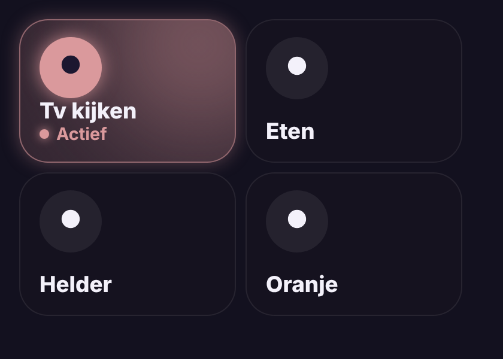

# Glow Scene Card

🇬🇧 [English](scene.md) · 🇳🇱 Nederlands



Een scèneknop die gloeit zolang de scène **actief** is: de lampen staan nog zoals de scène ze zette (aan/uit en helderheid, met een kleine marge). Pas je een lamp met de hand aan, dan dooft de gloed. Kloppen twee scènes met dezelfde lampen tegelijk, dan licht de laatst gestarte op.

- **Tik**: scène starten. **Lang drukken**: details.
- Werkt het best met scènes uit de scène-editor en een dashboardgebruiker met beheerdersrechten (de kaart leest de opgeslagen scène). Anders geldt: de laatst gestarte scène gloeit tot een van haar lampen verandert.

```yaml
type: custom:glow-scene-card
entity: scene.tv_kijken
```

| Optie | Standaard | Uitleg |
|---|---|---|
| `entity` | – | De scène. |
| `name` / `icon` | uit de scène | Naam en icoon. |
| `color` | uit de scène | Gloedkleur, bv. `"#FFB899"`; standaard de gemiddelde kleur van de lampen in de scène. |
| `tolerance` | `10` | Marge voor de helderheid in %. |
| `match_color` | `false` | Ook de kleuren vergelijken. |
| `glow` | `15` | Sterkte van de gloed in pixels. |
| `language` | automatisch | `nl`, `en`, `fr`, `de`, `es` of `it`. |
