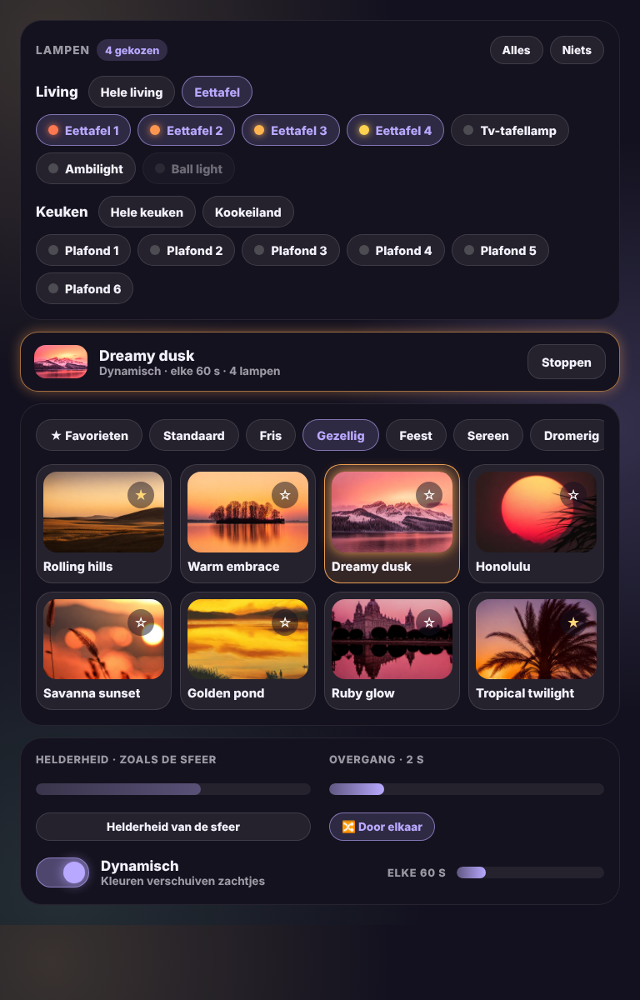

# Glow Scenes Card

🇬🇧 English · 🇳🇱 [Nederlands](scenes.nl.md)



A simple way to use the scenes of the [Scene presets](https://github.com/Hypfer/hass-scene_presets) integration, which you need installed.

- **Pick lights**: one line shows what is chosen ("Dining + TV lamp"). Tap *Change* to open it: switch between rooms, tap one of your light groups, or pick single lights. Light groups from Home Assistant (light groups, Zigbee2MQTT groups) are found automatically and count as one light, just like in Scene presets itself. Picking a group drops its own lights from the choice, and the other way round. The dot next to each light shows its current colour. The card remembers your choice on the device.
- **Scenes**: every Scene presets scene with its image, per category, including your custom scenes. One tap applies it to the chosen lights.
- **Favourites**: the star adds a scene to your favourites. With `favorites_entity` (an `input_text`) they are shared between all devices and users.
- **Settings**: the scene's brightness or your own, the transition, and shuffled colours.
- **Dynamic**: colours shift gently every x seconds. The card shows which dynamic scene is running, with a stop button.

```yaml
type: custom:glow-scenes-card
favorites_entity: input_text.scene_favourites
rooms:
  - name: Living room
    lights:
      - entity: light.dining_spot_1
        name: Dining 1
      - light.tv_lamp
    groups:
      - name: Dining table
        lights: [light.dining_spot_1, light.dining_spot_2]
```

Or simply all lights in some areas:

```yaml
type: custom:glow-scenes-card
areas: [living_room, kitchen]
```

| Option | Default | Description |
|---|---|---|
| `rooms` | – | Rooms with `name`, `lights` (entity or `{ entity, name }`) and optional `groups`. |
| `areas` | – | Instead of `rooms`: all lights in these areas. |
| `auto_groups` | `true` | Show your Home Assistant light groups as quick buttons. |
| `favorites_entity` | – | `input_text` (max. 255 characters) to share favourites. Without it each device keeps its own. |
| `glow` | `15` | Glow strength. |
| `language` | automatic | `en`, `nl`, `fr`, `de`, `es` or `it`. |
