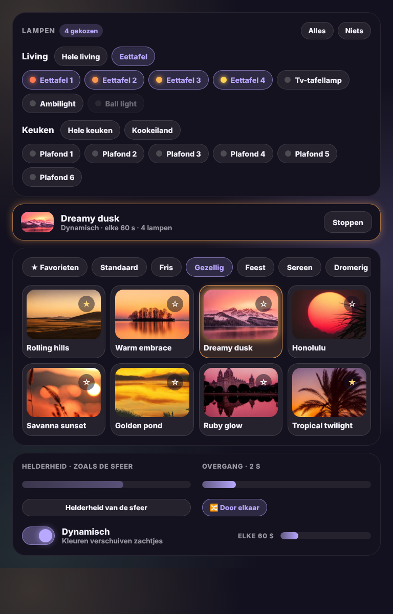

# Glow Scenes Card

🇬🇧 [English](scenes.md) · 🇳🇱 Nederlands



Een eenvoudige manier om de sferen van de integratie [Scene presets](https://github.com/Hypfer/hass-scene_presets) te gebruiken. Je hebt die integratie dus nodig.

- **Lampen kiezen**: één regel toont wat er gekozen is ("Eettafel + Tv-tafellamp"). Tik op *Aanpassen* om te kiezen: wissel tussen kamers, tik een van je lichtgroepen aan of kies losse lampen. Lichtgroepen uit Home Assistant (lichtgroepen, Zigbee2MQTT-groepen) worden vanzelf gevonden en tellen als één lamp, net zoals in Scene presets zelf. Kies je een groep, dan vallen haar eigen lampen uit de keuze, en omgekeerd. Het bolletje bij elke lamp toont de kleur die ze nu heeft. De kaart onthoudt je keuze op het toestel.
- **Sferen**: alle sferen van Scene presets met hun afbeelding, per groep (Standaard, Gezellig, Feest…), ook je eigen sferen. Eén tik zet de sfeer op de gekozen lampen.
- **Favorieten**: met de ster zet je een sfeer bij je favorieten. Met `favorites_entity` (een `input_text`) zijn ze gedeeld tussen al je toestellen en gebruikers.
- **Instellingen**: helderheid van de sfeer of je eigen helderheid, de overgang, en kleuren door elkaar.
- **Dynamisch**: de kleuren verschuiven elke x seconden zachtjes. De kaart toont welke dynamische sfeer er loopt, met een knop om ze te stoppen.

```yaml
type: custom:glow-scenes-card
favorites_entity: input_text.glow_sferen_favorieten
rooms:
  - name: Living
    lights:
      - entity: light.eettafel_spot_1
        name: Eettafel 1
      - light.tv_tafellamp
    groups:
      - name: Eettafel
        lights: [light.eettafel_spot_1, light.eettafel_spot_2]
  - name: Keuken
    lights: [light.keuken_spot_1, light.keuken_spot_2]
```

Of eenvoudiger, met alle lampen uit een ruimte:

```yaml
type: custom:glow-scenes-card
areas: [living, keuken]
```

| Optie | Standaard | Uitleg |
|---|---|---|
| `rooms` | – | Kamers met `name`, `lights` (entiteit of `{ entity, name }`) en optioneel `groups`. |
| `areas` | – | In plaats van `rooms`: alle lampen uit deze ruimtes. |
| `auto_groups` | `true` | Toon je lichtgroepen uit Home Assistant als snelknoppen. |
| `favorites_entity` | – | `input_text` (max. 255 tekens) om favorieten te delen. Zonder bewaart elk toestel zijn eigen favorieten. |
| `glow` | `15` | Sterkte van de gloed. |
| `language` | automatisch | `nl`, `en`, `fr`, `de`, `es` of `it`. |
