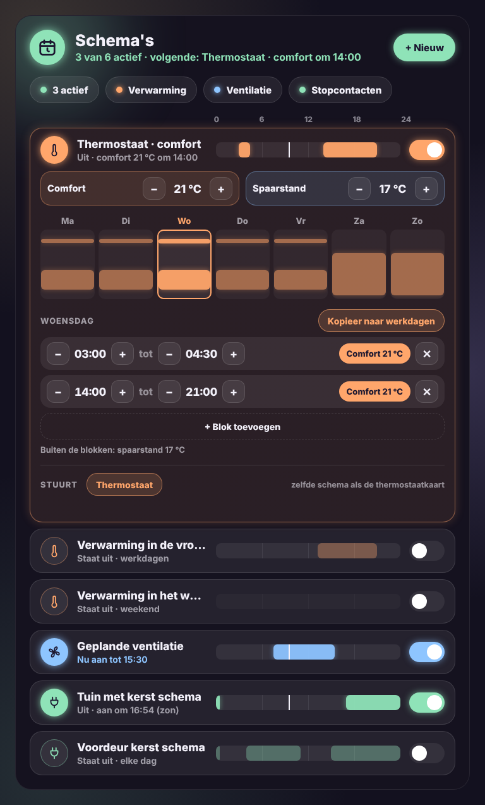

# Glow Schedule Card

🇬🇧 English · 🇳🇱 [Nederlands](schedule.nl.md)



All schedules of your home on one card: a timeline of today per schedule, a switch, and expand to change everything.

- **Scheduler**: the card shows the schedules of [Scheduler](https://github.com/nielsfaber/scheduler-component) (via HACS) and edits them there. Scheduler runs them inside Home Assistant, so they keep working when your screen is off.
- **Schedule helpers**: Home Assistant's own schedules are listed too, including the schedule of the [Glow Thermostat Card](thermostat.md). It keeps working in the thermostat card; a change in one card shows up in the other.
- **Expand**: tap a schedule for the days (every day, workdays, weekend or your own), a week overview and the blocks. Move start and end by 15 minutes with −/+, start at sunset, add or remove blocks. For heating you set the temperature per block.
- **Outside the blocks**: if the schedule already had an off action (e.g. heating off), the card fills the gaps with it. Otherwise nothing happens outside the blocks.
- **Controls**: pick another device of the same kind, for example after an entity was renamed.
- **New**: create a schedule for a light, plug, fan, blind or thermostat.
- **Conditions** you set in Scheduler are kept.

Changes are saved automatically after a second. A schedule with actions the card cannot edit can still be switched on and off; change the rest in Scheduler.

```yaml
type: custom:glow-schedule-card
```

| Option | Default | Description |
|---|---|---|
| `title` | Schedules | Title. |
| `entities` | all | Only show these schedules (`switch.schedule_…` or `schedule.…`), in this order. |
| `exclude` | – | Schedules to hide. |
| `helpers` | `true` | Show Home Assistant schedule helpers. |
| `glow` | `15` | Glow strength in px. |
| `language` | automatic | `nl`, `en`, `fr`, `de`, `es` or `it`. |

Below 560 px wide (phones) the timeline moves under the name.
