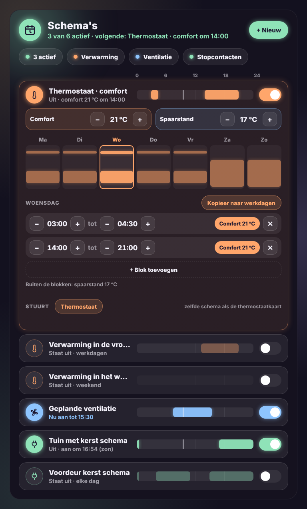

# Glow Schedule Card

🇬🇧 [English](schedule.md) · 🇳🇱 Nederlands



Alle schema's van je huis op één kaart: per schema een tijdbalk van vandaag, een schakelaar, en openklappen om alles aan te passen.

- **Scheduler**: de kaart toont de schema's van [Scheduler](https://github.com/nielsfaber/scheduler-component) (via HACS) en past ze daar ook aan. Scheduler voert ze uit in Home Assistant, dus ze lopen ook als je scherm uit staat.
- **Schema-helpers**: de schema's van Home Assistant zelf staan er ook bij, waaronder het schema van de [Glow Thermostat Card](thermostat.nl.md). Dat blijft in de thermostaatkaart werken; wat je in de ene kaart aanpast, zie je in de andere.
- **Openklappen**: tik op een schema voor de dagen (elke dag, werkdagen, weekend of zelf kiezen), een weekoverzicht en de blokken. Verschuif begin en einde per kwartier met −/+, start bij zonsondergang, voeg blokken toe of verwijder ze. Bij de verwarming kies je per blok de temperatuur.
- **Buiten de blokken**: had het schema al een uit-actie (bv. verwarming uit), dan vult de kaart de tussenstukken vanzelf daarmee aan. Anders gebeurt er buiten de blokken niets.
- **Stuurt**: kies een ander toestel van hetzelfde soort, bijvoorbeeld als een entiteit van naam veranderd is.
- **Nieuw**: maak een schema voor een lamp, stopcontact, ventilator, rolluik of thermostaat.
- **Voorwaarden** die je in Scheduler aan een schema gaf, blijven behouden.

Wijzigingen worden na een seconde vanzelf bewaard. Een schema met acties die de kaart niet kan aanpassen, kan je wel aan- en uitzetten; de rest pas je dan in Scheduler aan.

```yaml
type: custom:glow-schedule-card
```

| Optie | Standaard | Uitleg |
|---|---|---|
| `title` | Schema's | Titel. |
| `entities` | alle | Alleen deze schema's tonen (`switch.schedule_…` of `schedule.…`), in deze volgorde. |
| `exclude` | – | Schema's die je niet wil zien. |
| `helpers` | `true` | Schema-helpers van Home Assistant tonen. |
| `glow` | `15` | Sterkte van de gloed in px. |
| `language` | automatisch | `nl`, `en`, `fr`, `de`, `es` of `it`. |

Onder 560 px breed (gsm) komt de tijdbalk onder de naam.
