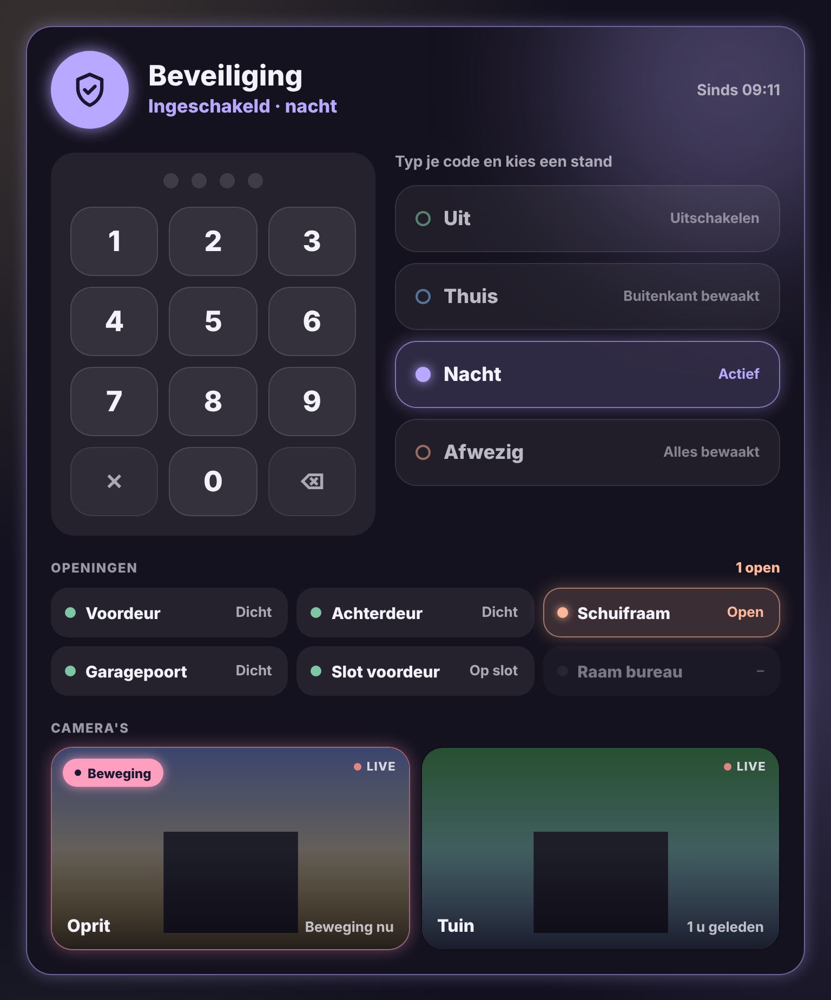

# Glow Security Card

🇬🇧 English · 🇳🇱 [Nederlands](security.nl.md)



A large security card for [Alarmo](https://github.com/nielsfaber/alarmo) or any other alarm panel in Home Assistant. It is meant to fill (almost) a whole screen.

- **Status**: a shield glowing in the colour of the mode: off green, home blue, night lavender, away peach, arming yellow, alarm red. During the exit or entry delay the card counts down.
- **Keypad**: always visible. Enter your code and tap a mode. Without a code the card says "Enter your code first". If the code is wrong, the card tells you. A half-typed code is cleared after 30 seconds.
- **Modes**: large buttons with a short description you can change. Only the modes your alarm supports are shown.
- **Openings**: the doors, windows, gates and locks you choose. Whatever is open glows, with "All closed" or "2 open" at the top.
- **Cameras**: the cameras you choose, with a picture and a pink glow on motion. The motion sensor of the same camera (e.g. Reolink) is found automatically.

Tap the shield, an opening or a camera for the standard details (for a camera: the large live view).

```yaml
type: custom:glow-security-card
entity: alarm_control_panel.alarmo
openings:
  - binary_sensor.front_door
  - binary_sensor.sliding_window
  - cover.garage_door
cameras:
  - camera.driveway
  - camera.garden
```

| Option | Default | Description |
|---|---|---|
| `entity` | – | The alarm panel, e.g. `alarm_control_panel.alarmo`. |
| `name` | Security | Card title. |
| `modes` | off, home, night, away | Which modes appear as buttons: `disarmed`, `armed_home`, `armed_night`, `armed_away`, `armed_vacation`, `armed_custom_bypass`. |
| `descriptions` | default text | Text per mode, e.g. `{ armed_home: 'Perimeter guarded' }`. |
| `openings` | all door and window sensors | `binary_sensor`, `cover` and `lock` entities. |
| `cameras` | – | List of `camera` entities. `{ entity: camera.driveway, name: Driveway, motion: binary_sensor.driveway_person }` works too. |
| `live` | `false` | Live video in the tiles. Off: a new snapshot every few seconds (lighter on the tablet). |
| `refresh` | `10` | Seconds between snapshots when `live` is off. |
| `glow` | `15` | Glow strength in pixels. |
| `language` | automatic | `en`, `nl`, `fr`, `de`, `es` or `it`. |

The code goes straight to the alarm panel. The card does not store or check it.

In a narrower spot the mode buttons move below the keypad.
