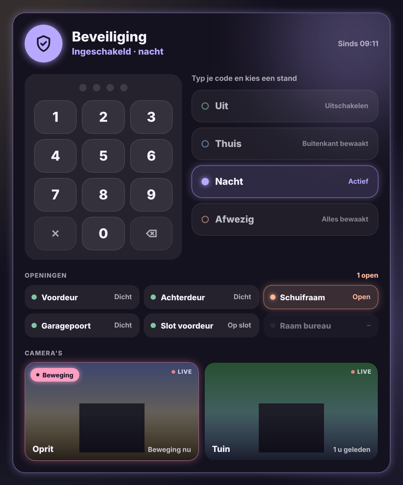

# Glow Security Card

🇬🇧 [English](security.md) · 🇳🇱 Nederlands



Een grote beveiligingskaart voor [Alarmo](https://github.com/nielsfaber/alarmo) of een ander alarmpaneel in Home Assistant. Ze is bedoeld om (bijna) een volledig scherm te vullen.

- **Status**: een schild dat gloeit in de kleur van de stand: uit groen, thuis blauw, nacht lavendel, afwezig perzik, aan het inschakelen geel, alarm rood. Tijdens de uitloop- of ingangsvertraging telt de kaart af.
- **Klavier**: altijd zichtbaar. Typ je code en tik op een stand. Zonder code verschijnt "Typ eerst je code". Klopt de code niet, dan zegt de kaart dat. Een half ingetypte code verdwijnt na 30 seconden.
- **Standen**: grote knoppen met een korte uitleg, die je zelf kunt aanpassen. Alleen de standen die je alarm ondersteunt, worden getoond.
- **Openingen**: de deuren, ramen, poorten en sloten die je kiest. Wat open staat, gloeit, en bovenaan staat "Alles dicht" of "2 open".
- **Camera's**: de camera's die je kiest, met beeld en een roze gloed bij beweging. De bewegingssensor van dezelfde camera (bv. Reolink) wordt automatisch gevonden.

Tik op het schild, een opening of een camera voor de gewone details (bij een camera: het grote live beeld).

```yaml
type: custom:glow-security-card
entity: alarm_control_panel.alarmo
openings:
  - binary_sensor.voordeur
  - binary_sensor.schuifraam
  - cover.garagepoort
cameras:
  - camera.oprit
  - camera.tuin
```

| Optie | Standaard | Uitleg |
|---|---|---|
| `entity` | – | Het alarmpaneel, bv. `alarm_control_panel.alarmo`. |
| `name` | Beveiliging | Titel van de kaart. |
| `modes` | uit, thuis, nacht, afwezig | Welke standen als knop verschijnen: `disarmed`, `armed_home`, `armed_night`, `armed_away`, `armed_vacation`, `armed_custom_bypass`. |
| `descriptions` | standaardtekst | Uitleg per stand, bv. `{ armed_home: 'Buitenkant bewaakt' }`. |
| `openings` | alle deur- en raamsensoren | `binary_sensor`-, `cover`- en `lock`-entiteiten. |
| `cameras` | – | Lijst met `camera`-entiteiten. Ook `{ entity: camera.oprit, name: Oprit, motion: binary_sensor.oprit_persoon }` kan. |
| `live` | `false` | Live video in de tegels. Uit: om de paar seconden een nieuwe foto (zuiniger voor de tablet). |
| `refresh` | `10` | Seconden tussen twee foto's als `live` uit staat. |
| `glow` | `15` | Sterkte van de gloed in pixels. |
| `language` | automatisch | `nl`, `en`, `fr`, `de`, `es` of `it`. |

De code gaat rechtstreeks naar het alarmpaneel. De kaart bewaart ze niet en controleert ze niet zelf.

Op een smallere plek schuiven de standknoppen onder het klavier.
