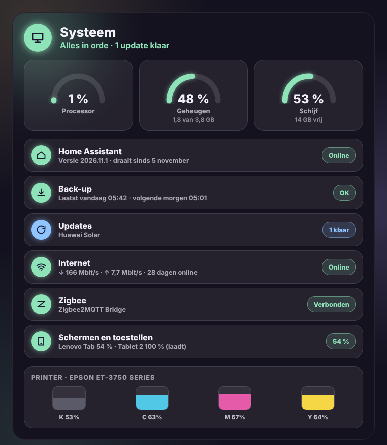

# Glow System Card

🇬🇧 English · 🇳🇱 [Nederlands](system.nl.md)



How is Home Assistant doing? The card finds everything itself.

- **Gauges** for processor, memory and disk (System Monitor integration).
- **Home Assistant**: version and how long it has been running.
- **Backup**: last and next; red when the last one is older than 2 days.
- **Updates** that are ready; tap to open the updates.
- **Internet**, **Zigbee** and your **screens** (battery, charging).
- **Printer**: ink tanks of all `*_ink` sensors.

```yaml
type: custom:glow-system-card
devices:
  - entity: sensor.lenovo_tab_batterij
    name: Tablet
    charging: binary_sensor.lenovo_tab_op_voeding_aangesloten
```

| Option | Default | Description |
|---|---|---|
| `devices` | – | Devices with a battery: `entity`, `name`, `charging`. |
| `inks` | automatic | Ink sensors. |
| `printer_name` | automatic | Printer name. |
| `cpu` / `memory` / `disk` | automatic | Sensors in %. |
| `internet` / `download` / `upload` | automatic | Connection and speeds. |
| `zigbee` | automatic | Zigbee connected sensor. |
| `glow` | `15` | Glow strength. |
| `language` | automatic | `nl`, `en`, `fr`, `de`, `es` or `it`. |
