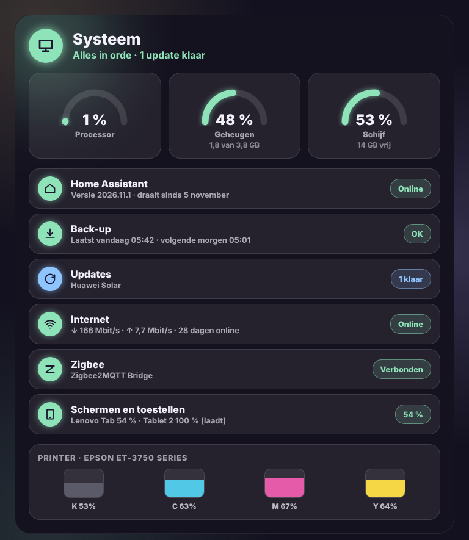

# Glow System Card

🇬🇧 [English](system.md) · 🇳🇱 Nederlands



Hoe gaat het met Home Assistant? De kaart vindt alles zelf.

- **Meters** voor processor, geheugen en schijf (integratie System Monitor).
- **Home Assistant**: versie en sinds wanneer het draait.
- **Back-up**: laatste en volgende; rood als de laatste ouder is dan 2 dagen.
- **Updates** die klaarstaan; tik om naar de updates te gaan.
- **Internet**, **Zigbee** en je **schermen** (batterij, laden).
- **Printer**: de inktpotjes van alle `*_ink`-sensoren.

```yaml
type: custom:glow-system-card
devices:
  - entity: sensor.lenovo_tab_batterij
    name: Tablet
    charging: binary_sensor.lenovo_tab_op_voeding_aangesloten
```

| Optie | Standaard | Uitleg |
|---|---|---|
| `devices` | – | Toestellen met batterij: `entity`, `name`, `charging`. |
| `inks` | automatisch | Inktsensoren. |
| `printer_name` | automatisch | Naam van de printer. |
| `cpu` / `memory` / `disk` | automatisch | Sensoren in %. |
| `internet` / `download` / `upload` | automatisch | Verbinding en snelheden. |
| `zigbee` | automatisch | Verbonden-sensor van Zigbee. |
| `glow` | `15` | Sterkte van de gloed. |
| `language` | automatisch | `nl`, `en`, `fr`, `de`, `es` of `it`. |
