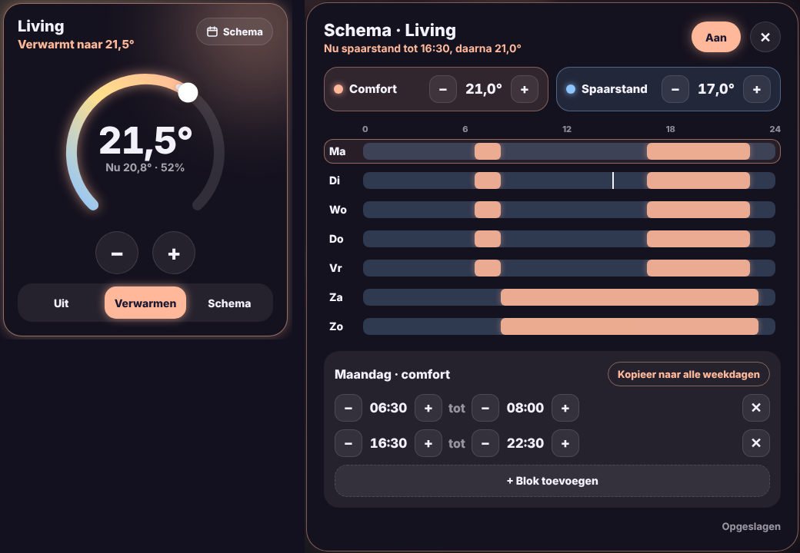

# Glow Thermostat Card

🇬🇧 English · 🇳🇱 [Nederlands](thermostat.nl.md)



A thermostat card in the Glow style, with a weekly schedule that runs entirely in Home Assistant.

- **Dial**: drag along the arc or use − and + (half a degree per step). The temperature is sent after a short pause, so quick taps become one command.
- **Centre**: the target temperature, with the current temperature and humidity below.
- **Glow**: peach while heating, lavender at temperature, grey when off.
- **Modes**: **Off**, **Heat** (set the temperature yourself) and **Schedule**.
- **Schedule** (button top right): a popup with the weekly schedule.

## The schedule

The schedule has two temperatures: **comfort** and **eco**. You draw the comfort blocks per day; the rest of the time eco applies.

- Tap a day and move the start and end times in half hours, add or remove blocks.
- **Copy to all weekdays** (or to the weekend) copies the selected day.
- Changes are saved automatically after a second.
- If you change the temperature by hand while the schedule runs, that holds until the next block starts or ends.

### One-time setup

The first time you tap **Schedule**, the card shows **Set up schedule**. It creates in Home Assistant (needs an administrator account):

| What | Entity (for `climate.thermostat`) |
|---|---|
| Schedule helper with an example week | `schedule.thermostat_schema` |
| Comfort temperature | `input_number.thermostat_comfort` |
| Eco temperature | `input_number.thermostat_spaarstand` |
| "Schedule active" switch | `input_boolean.thermostat_schema_actief` |
| Automation that sets the temperature | *Glow thermostaat schema (climate.thermostat)* |

After that everything runs in Home Assistant itself, even when the tablet is off. You can also create the helpers yourself and pick them in the editor.

```yaml
type: custom:glow-thermostat-card
entity: climate.thermostat
```

| Option | Default | Description |
|---|---|---|
| `entity` | – | The thermostat (`climate`). |
| `name` | entity name | Name on the card. |
| `humidity` | from the thermostat | Your own humidity sensor. |
| `schedule` | `schedule.<name>_schema` | The schedule helper. |
| `comfort` | `input_number.<name>_comfort` | Comfort temperature. |
| `eco` | `input_number.<name>_spaarstand` | Eco temperature. |
| `active` | `input_boolean.<name>_schema_actief` | Schedule on or off. |
| `glow` | `15` | Glow strength in pixels. |
| `language` | automatic | `en`, `nl`, `fr`, `de`, `es` or `it`. |
