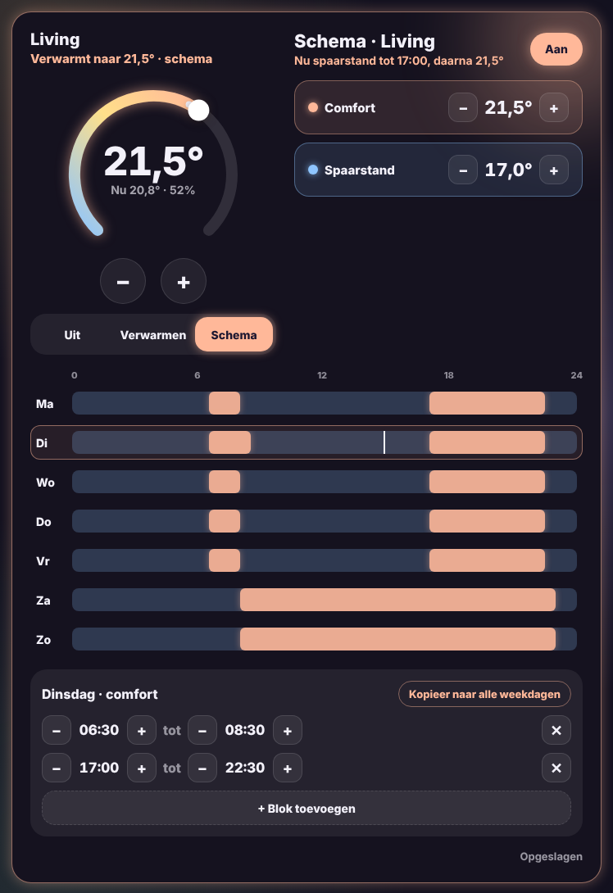

# Glow Thermostat Card

🇬🇧 [English](thermostat.md) · 🇳🇱 Nederlands



Een thermostaatkaart in de Glow-stijl, met een weekschema dat volledig in Home Assistant draait.

- **Draaiknop**: sleep over de boog of gebruik − en + (per halve graad). De temperatuur wordt pas na een korte pauze verstuurd, zodat snel tikken één opdracht wordt.
- **Midden**: de ingestelde temperatuur, met eronder de huidige temperatuur en vochtigheid.
- **Gloed**: perzik als de ketel verwarmt, lavendel als het op temperatuur is, grijs als de thermostaat uit staat.
- **Standen**: **Uit**, **Verwarmen** (zelf de temperatuur kiezen) en **Schema**.
- **Schema**: standaard staat het weekschema mee op de kaart, die dan bijna een volledig scherm vult (bedoeld voor een eigen view). Met `layout: compact` wordt de kaart één kolom breed en opent het schema in een popup via de knop rechtsboven.

## Het schema

Het schema kent twee temperaturen: **comfort** en **spaarstand**. Je tekent per dag de comfortblokken, de rest van de tijd geldt de spaarstand.

- Tik op een dag en verschuif de begin- en einduren per half uur, voeg blokken toe of verwijder ze.
- **Kopieer naar alle weekdagen** (of naar het weekend) neemt de gekozen dag over.
- Wijzigingen worden na een seconde automatisch opgeslagen.
- Pas je de temperatuur met de hand aan terwijl het schema loopt, dan geldt dat tot het volgende blok begint of eindigt.

### Eenmalig instellen

Zolang het schema nog niet bestaat, toont de kaart de knop **Schema instellen**. Die maakt in Home Assistant aan (vraagt een beheerdersaccount):

| Wat | Entiteit (voor `climate.thermostaat`) |
|---|---|
| Schema-helper met een voorbeeldweek | `schedule.thermostaat_schema` |
| Comforttemperatuur | `input_number.thermostaat_comfort` |
| Spaartemperatuur | `input_number.thermostaat_spaarstand` |
| Schakelaar "schema actief" | `input_boolean.thermostaat_schema_actief` |
| Automatisering die de temperatuur zet | *Glow thermostaat schema (climate.thermostaat)* |

Daarna loopt alles in Home Assistant zelf, ook als de tablet uit staat. Je kunt de helpers ook zelf maken en ze in de editor kiezen.

```yaml
type: custom:glow-thermostat-card
entity: climate.thermostaat
```

| Optie | Standaard | Uitleg |
|---|---|---|
| `entity` | – | De thermostaat (`climate`). |
| `name` | naam van de entiteit | Naam op de kaart. |
| `humidity` | van de thermostaat | Eigen vochtigheidssensor. |
| `layout` | `full` | `full`: groot, met het schema op de kaart. `compact`: klein, schema in een popup. |
| `schedule` | `schedule.<naam>_schema` | De Schema-helper. |
| `comfort` | `input_number.<naam>_comfort` | Comforttemperatuur. |
| `eco` | `input_number.<naam>_spaarstand` | Spaartemperatuur. |
| `active` | `input_boolean.<naam>_schema_actief` | Schema aan of uit. |
| `glow` | `15` | Sterkte van de gloed in pixels. |
| `language` | automatisch | `nl`, `en`, `fr`, `de`, `es` of `it`. |
