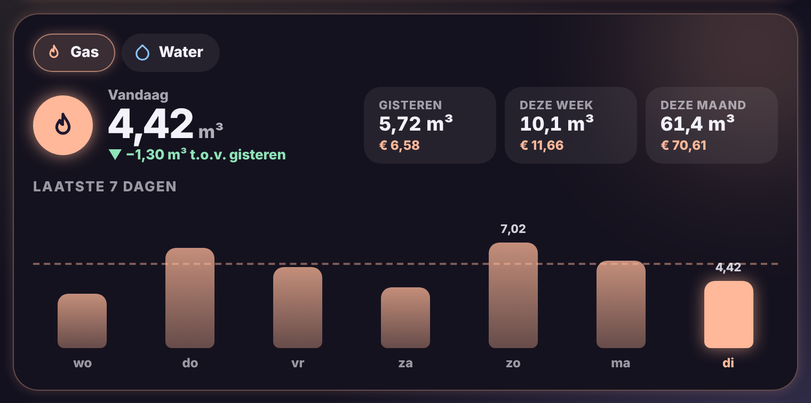

# Glow Usage Card

🇬🇧 English · 🇳🇱 [Nederlands](usage.nl.md)



Gas, water and electricity usage (or any meter) in one card.

- **Today** in large, with an arrow showing how much more or less than yesterday: green when you use less, peach when it is more.
- **Yesterday, this week and this month** in three boxes, with the cost when you set a price.
- **Bars** for the last 7 days (up to 31), with a dashed line for the average and today glowing.
- **Several meters**: switch at the top between e.g. gas, water and electricity. Gas is peach, water blue, electricity yellow.
- **Day and night tariff together**: give a list of sensors for one meter and the card adds them up.

The numbers come from Home Assistant's long-term statistics, the same as the energy dashboard. So use the **total meter reading** (a sensor with `state_class: total_increasing`, e.g. from your smart meter or P1 reader).

```yaml
type: custom:glow-usage-card
meters:
  - sensor.gas_verbruik
  - sensor.water_verbruik
  - entity:                      # day + night summed
      - sensor.import_day
      - sensor.import_night
    name: Electricity
gas_price: 1.15
water_price: 5.2
energy_price: 0.32
```

| Option | Default | Description |
|---|---|---|
| `meters` | – | List of meters. `{ entity: sensor.water, name: Water, color: '#8EC5FF', price: 5.2 }` works too. `entity` can also be a list of sensors that are summed. |
| `name` | – | Title above the card. |
| `gas_price` | – | Price per unit of gas (e.g. per m³). |
| `water_price` | – | Price per unit of water. |
| `energy_price` | – | Price per kWh of electricity. |
| `days` | `7` | Days in the chart (3 to 31). |
| `glow` | `15` | Glow strength. |
| `language` | automatic | `en`, `nl`, `fr`, `de`, `es` or `it`. |
